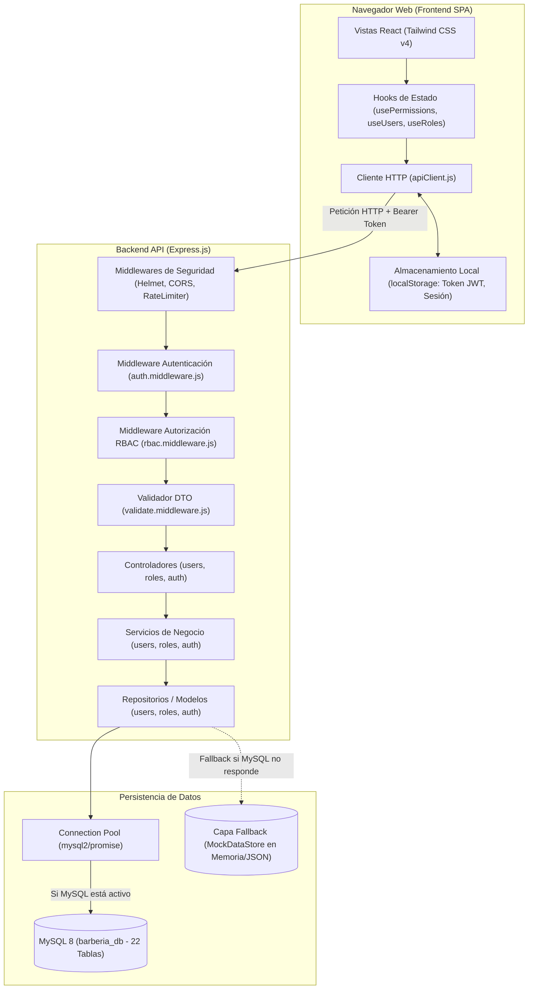
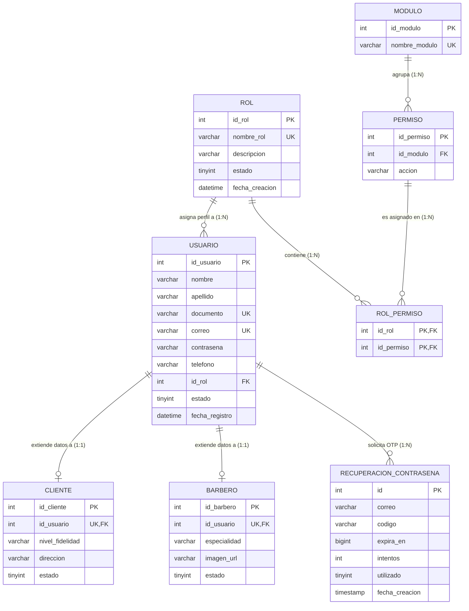
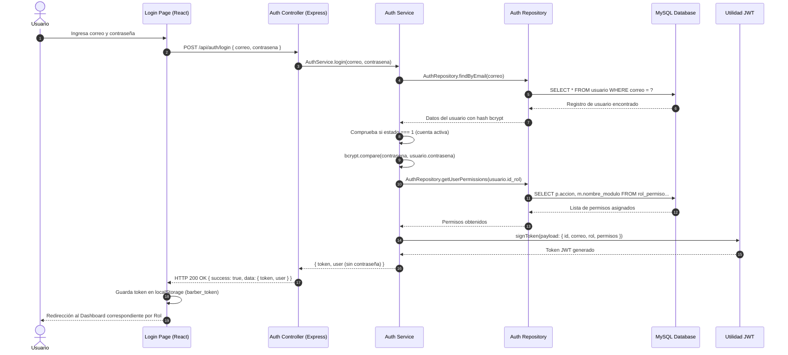

# 💈 AUDITORÍA TÉCNICA Y GUÍA DE ESTUDIO PARA EXAMEN ORAL
## SISTEMA INTEGRAL DE GESTIÓN: "TU TURNO BARBER"
### Módulos de Enfoque: 1. Roles | 2. Permisos | 3. Gestión de Usuarios | 4. Gestión de Acceso

---

## 📑 ÍNDICE GENERAL

1. [Fase 1: Reconocimiento Integral y Mapa de Arquitectura](#fase-1-reconocimiento-integral-y-mapa-de-arquitectura)
2. [Fase 2: Auditoría Técnica Individual de Módulos](#fase-2-auditoría-técnica-individual-de-módulos)
   - [Módulo 1: Roles](#módulo-1-roles)
   - [Módulo 2: Permisos](#módulo-2-permisos)
   - [Módulo 3: Gestión de Usuarios](#módulo-3-gestión-de-usuarios)
   - [Módulo 4: Gestión de Acceso](#módulo-4-gestión-de-acceso)
3. [Fase 3: Reconstrucción de Flujos de Ejecución de Extremo a Extremo (E2E)](#fase-3-reconstrucción-de-flujos-de-ejecución-de-extremo-a-extremo-e2e)
4. [Fase 4: Auditoría de Calidad de Software, Integridad y Seguridad](#fase-4-auditoría-de-calidad-de-software-integridad-y-seguridad)
5. [Fase 5: Clases Magistrales Universitarias (Lecciones 1 a 6 por Módulo)](#fase-5-clases-magistrales-universitarias)
   - [Clase Magistral: Roles](#clase-magistral-roles)
   - [Clase Magistral: Permisos](#clase-magistral-permisos)
   - [Clase Magistral: Gestión de Usuarios](#clase-magistral-gestión-de-usuarios)
   - [Clase Magistral: Gestión de Acceso](#clase-magistral-gestión-de-acceso)
6. [Fase 6: Diagramas de Arquitectura y Matriz de Trazabilidad](#fase-6-diagramas-de-arquitectura-y-matriz-de-trazabilidad)
7. [Fase 7: Guiones de Defensa Oral de Alto Impacto (1 a 3 Minutos)](#fase-7-guiones-de-defensa-oral-de-alto-impacto)
8. [Fase 8: Glosario Técnico y Plan de Estudio Estratégico](#fase-8-glosario-técnico-y-plan-de-estudio-estratégico)
9. [Fase 9: Inventario de Archivos Inspeccionados y Limitaciones de Verificación](#fase-9-inventario-de-archivos-inspeccionados-y-limitaciones-de-verificación)

---

## FASE 1: RECONOCIMIENTO INTEGRAL Y MAPA DE ARQUITECTURA

### 1.1 Tecnologías Descubiertas mediante Inspección de Código

Tras auditar exhaustivamente los descriptores del repositorio ([`package.json`](file:///c:/Users/crist/OneDrive/Escritorio/proyecto_barber/package.json), [`Backend/package.json`](file:///c:/Users/crist/OneDrive/Escritorio/proyecto_barber/Backend/package.json), [`frontend/package.json`](file:///c:/Users/crist/OneDrive/Escritorio/proyecto_barber/frontend/package.json)), el script maestro [`dev.js`](file:///c:/Users/crist/OneDrive/Escritorio/proyecto_barber/dev.js) y las carpetas de código fuente, se identificó el siguiente ecosistema real:

| Capa | Tecnología / Biblioteca | Versión Real | Propósito en el Proyecto | Evidencia en Código |
|---|---|---|---|---|
| **Frontend Framework** | React + Vite | React 18.3.1 / Vite 6.3.5 | SPA interactiva, renderizado del DOM reactivo | [`frontend/package.json:6-9`](file:///c:/Users/crist/OneDrive/Escritorio/proyecto_barber/frontend/package.json#L6-L9) |
| **Enrutamiento Web** | React Router | 7.13.0 | Definición declarativa de rutas y guardianes de acceso | [`frontend/src/features/AppRoutes.jsx`](file:///c:/Users/crist/OneDrive/Escritorio/proyecto_barber/frontend/src/features/AppRoutes.jsx) |
| **Estilos & UI** | Tailwind CSS v4 + Radix UI + Lucide | Tailwind 4.1.12 | Sistema de diseño responsivo, dark/light mode, modales accesibles e iconos | [`frontend/package.json:13-52`](file:///c:/Users/crist/OneDrive/Escritorio/proyecto_barber/frontend/package.json#L13-L52) |
| **Notificaciones UI** | Sonner | 2.0.3 | Notificaciones toast flotantes reactivas | [`frontend/src/features/admin/roles/hooks/useRoles.js:2`](file:///c:/Users/crist/OneDrive/Escritorio/proyecto_barber/frontend/src/features/admin/roles/hooks/useRoles.js#L2) |
| **Backend Runtime** | Node.js (ES Modules nativos) | Node 18+ (`"type": "module"`) | Servidor asíncrono basado en JavaScript moderno | [`Backend/package.json:6`](file:///c:/Users/crist/OneDrive/Escritorio/proyecto_barber/Backend/package.json#L6) |
| **Framework HTTP** | Express.js | 4.21.2 | Servidor REST, middleware pipeline, enrutamiento | [`Backend/src/app.js`](file:///c:/Users/crist/OneDrive/Escritorio/proyecto_barber/Backend/src/app.js) |
| **Base de Datos** | MySQL 8 Relacional | Driver `mysql2/promise` 3.12.0 | Motor relacional transaccional ACID con Connection Pooling | [`Backend/src/config/db.js`](file:///c:/Users/crist/OneDrive/Escritorio/proyecto_barber/Backend/src/config/db.js) |
| **Capa de Resiliencia** | MockDataStore en memoria/JSON | Implementación propia | Fallback automático que replica el esquema MySQL en desarrollo si la BD local no responde | [`Backend/src/config/mockStore.js`](file:///c:/Users/crist/OneDrive/Escritorio/proyecto_barber/Backend/src/config/mockStore.js) |
| **Seguridad: Hashing** | bcryptjs | 2.4.3 | Cifrado unidireccional de contraseñas (10 rounds de salt) | [`Backend/src/utils/password.js`](file:///c:/Users/crist/OneDrive/Escritorio/proyecto_barber/Backend/src/utils/password.js) |
| **Seguridad: Tokens** | jsonwebtoken | 9.0.2 | Generación y verificación criptográfica de JWT (HS256) | [`Backend/src/utils/jwt.js`](file:///c:/Users/crist/OneDrive/Escritorio/proyecto_barber/Backend/src/utils/jwt.js) |
| **Seguridad: Headers** | Helmet | 8.0.0 | Cabeceras HTTP de protección (X-Content-Type, XSS, etc.) | [`Backend/src/app.js:42-46`](file:///c:/Users/crist/OneDrive/Escritorio/proyecto_barber/Backend/src/app.js#L42-L46) |
| **Rate Limiting** | express-rate-limit | 7.5.0 | Prevención de fuerza bruta en login/registro (30 peticiones / 15 min en producción) | [`Backend/src/middlewares/rateLimiter.middleware.js`](file:///c:/Users/crist/OneDrive/Escritorio/proyecto_barber/Backend/src/middlewares/rateLimiter.middleware.js) |
| **Validaciones Backend** | express-validator | 7.2.1 | Validación de esquemas, sanitización y tipado de DTOs en entrada | [`Backend/src/validators/`](file:///c:/Users/crist/OneDrive/Escritorio/proyecto_barber/Backend/src/validators/) |
| **Documentación API** | Swagger UI Express | 5.0.1 | Documentación viva OpenAPI 3.0 servida en `/api/docs` | [`Backend/src/app.js:98`](file:///c:/Users/crist/OneDrive/Escritorio/proyecto_barber/Backend/src/app.js#L98) |
| **Testing Automatizado** | Jest + Supertest | Jest 29.7.0 / Supertest 7.0.0 | Pruebas de integración HTTP y validación de RBAC | [`Backend/tests/`](file:///c:/Users/crist/OneDrive/Escritorio/proyecto_barber/Backend/tests/) |

---

### 1.2 Mapa General de la Arquitectura del Sistema

El sistema implementa una **Arquitectura en Capas Limpia (Clean Layered Architecture)** desacoplada, donde cada capa tiene responsabilidades únicas y unidireccionales:

```
[ FRONTEND SPA: React 18 + Vite ]
   ├── Views / Pages (RolesPage, UsersPage, Login, Portal)
   ├── Hooks & State (useRoles, useUsers, usePermissions)
   ├── Client HTTP (apiClient.js -> Fetch API con inyección de Bearer JWT)
   └── Validations (userValidation.js, roleValidation.js)
           │
           │ HTTP / HTTPS (JSON REST)
           ▼
[ BACKEND API: Express.js Pipeline ]
   ├── Global Middlewares (Helmet, CORS, Morgan, express.json)
   ├── Rate Limiter (rateLimiter.middleware.js)
   ├── Routing (auth.routes.js, users.routes.js, roles.routes.js)
   ├── Authentication Middleware (auth.middleware.js -> verifyToken)
   ├── Dynamic RBAC Middleware (rbac.middleware.js -> authorizePermission)
   ├── DTO Validation Middleware (validate.middleware.js -> express-validator)
   ├── Controllers (auth.controller.js, users.controller.js, roles.controller.js)
   ├── Services / Casos de Uso (auth.service.js, users.service.js, roles.service.js)
   ├── Repositories / Modelos (auth.model.js, users.model.js, roles.model.js)
   └── Error Handling (errorHandler.middleware.js -> ApiError)
           │
           ├──────────────────────────────┐
           ▼ (Si MySQL está en línea)     ▼ (Si MySQL no responde)
[ PERSISTENCIA RELACIONAL: MySQL 8 ]  [ CAPA DE RESILIENCIA: MockStore ]
   ├── Pool de Conexiones (db.js)         └── JSON Database en memoria / disco
   ├── Tablas Físicas (Database.sql)
   └── Transacciones ACID
```

---

## FASE 2: AUDITORÍA TÉCNICA INDIVIDUAL DE MÓDULOS

---

### MÓDULO 1: ROLES

#### A. Comprensión Funcional y Reglas de Negocio
- **¿Qué es este módulo?** Es el subsistema encargado de catalogar los perfiles de usuario que operan en la barbería y asignarles un paquete de capacidades autorizadas.
- **¿Qué problema resuelve en la barbería?** Evita el caos operativo y la fuga de datos. En una barbería tradicional, el dueño no puede permitir que un barbero recién contratado consulte los costos de compra a proveedores o modifique el inventario, ni que un cliente modifique la agenda de otros clientes. Los roles delimitan exactamente qué pantalla y acción puede realizar cada miembro.
- **¿Qué operaciones permite realizar?**
  1. Listar roles con conteo de usuarios asociados (`GET /api/roles`).
  2. Consultar el detalle de un rol con su lista de permisos (`GET /api/roles/:id`).
  3. Crear roles personalizados (`POST /api/roles`).
  4. Modificar nombre, descripción y matriz de permisos de un rol (`PUT /api/roles/:id`).
  5. Activar o desactivar roles (`PATCH /api/roles/:id/status`).
  6. Eliminar roles (`DELETE /api/roles/:id`).
  7. Consultar la matriz general de módulos del sistema (`GET /api/roles/modules/matrix`).
- **Roles predefinidos en la base de datos (Semilla oficial):**
  - `ID 1`: **Administrador** (Control total del sistema).
  - `ID 2`: **Recepcionista** (Gestión de agenda, ventas, clientes e inventario).
  - `ID 3`: **Barbero** (Consulta de agenda propia, registro de novedades y horarios).
  - `ID 4`: **Cliente** (Agendamiento de citas, consulta de catálogo y compras propias).
- **Reglas de Negocio Implementadas en Código:**
  1. **Protección Anti-Lockout del Administrador**: El rol 1 (Administrador) **nunca** puede perder los permisos sobre el módulo de roles (`roles_ver`, `roles_crear`, `roles_editar`, `roles_eliminar`, `roles_asignar`). Esta regla está forzada tanto en el repositorio backend ([`roles.model.js:176-180`](file:///c:/Users/crist/OneDrive/Escritorio/proyecto_barber/Backend/src/models/roles.model.js#L176-L180)), en el middleware de autorización ([`rbac.middleware.js:65-68`](file:///c:/Users/crist/OneDrive/Escritorio/proyecto_barber/Backend/src/middlewares/rbac.middleware.js#L65-L68)) como en el hook del frontend ([`usePermissions.js:56-59`](file:///c:/Users/crist/OneDrive/Escritorio/proyecto_barber/frontend/src/features/auth/hooks/usePermissions.js#L56-L59)).
  2. **Inmutabilidad de Eliminación de Roles Base**: En el servicio backend ([`roles.service.js:45-47`](file:///c:/Users/crist/OneDrive/Escritorio/proyecto_barber/Backend/src/services/roles.service.js#L45-L47)), los roles con ID 1, 2, 3 y 4 **no pueden ser eliminados**. Si se intenta, se emite un error HTTP 400 Bad Request.
  3. **Unicidad de Nombre de Rol**: La columna `nombre_rol` tiene restricción `UNIQUE` en MySQL ([`Database.sql:497`](file:///c:/Users/crist/OneDrive/Escritorio/proyecto_barber/Data_Base/Database.sql#L497)), impidiendo duplicados.

#### B. Frontend del Módulo de Roles
- **Vista Principal**: [`RolesPage.jsx`](file:///c:/Users/crist/OneDrive/Escritorio/proyecto_barber/frontend/src/features/admin/roles/pages/RolesPage.jsx).
- **Componentes Clave**:
  - [`RolesTable.jsx`](file:///c:/Users/crist/OneDrive/Escritorio/proyecto_barber/frontend/src/features/admin/roles/components/RolesTable.jsx): Renderizado de la tabla con ordenamiento por columnas, badges de estado y botones de acción.
  - [`RoleCard.jsx`](file:///c:/Users/crist/OneDrive/Escritorio/proyecto_barber/frontend/src/features/admin/roles/components/RoleCard.jsx): Vista alternativa en cuadrícula/tarjetas.
  - [`RoleFormModal.jsx`](file:///c:/Users/crist/OneDrive/Escritorio/proyecto_barber/frontend/src/features/admin/roles/components/RoleFormModal.jsx): Ventana modal para crear y editar roles, integrando la matriz de checkboxes por módulo (`RolePermissionBlock.jsx`).
  - [`RoleDetailModal.jsx`](file:///c:/Users/crist/OneDrive/Escritorio/proyecto_barber/frontend/src/features/admin/roles/components/RoleDetailModal.jsx): Vista de lectura detallada del rol y sus permisos activos.
  - [`RolesStats.jsx`](file:///c:/Users/crist/OneDrive/Escritorio/proyecto_barber/frontend/src/features/admin/roles/components/RolesStats.jsx): Métricas superiores (Total roles, Roles activos, Roles inactivos, Total usuarios asignados).
- **Control de Interfaz mediante Permisos**:
  En [`RolesPage.jsx:60-65`](file:///c:/Users/crist/OneDrive/Escritorio/proyecto_barber/frontend/src/features/admin/roles/pages/RolesPage.jsx#L60-L65):
  ```javascript
  const { hasPermission } = usePermissions();
  const canCreateRole = hasPermission("roles", "crear");
  const canEditRole = hasPermission("roles", "editar");
  const canDeleteRole = hasPermission("roles", "eliminar");
  ```
  Si el rol del usuario conectado no tiene `roles_crear`, el botón "Nuevo Rol" no se renderiza en el DOM.

#### C. Backend del Módulo de Roles
- **Rutas**: [`roles.routes.js`](file:///c:/Users/crist/OneDrive/Escritorio/proyecto_barber/Backend/src/routes/roles.routes.js). Aplica `authenticate` y `authorizePermission("roles", "<accion>")` en cada endpoint.
- **Controlador**: [`roles.controller.js`](file:///c:/Users/crist/OneDrive/Escritorio/proyecto_barber/Backend/src/controllers/roles.controller.js). Extrae parámetros, delega al servicio y retorna respuestas uniformes con `ApiResponse.success` o `ApiResponse.created`.
- **Servicio**: [`roles.service.js`](file:///c:/Users/crist/OneDrive/Escritorio/proyecto_barber/Backend/src/services/roles.service.js). Implementa la lógica de negocio (validar existencia del rol, bloquear eliminación de IDs 1 al 4).
- **Repositorio / Modelo**: [`roles.model.js`](file:///c:/Users/crist/OneDrive/Escritorio/proyecto_barber/Backend/src/models/roles.model.js). Utiliza `executeTransaction` para garantizar atomicidad cuando se crea o actualiza un rol junto con sus permisos en la tabla intermedia `rol_permiso`.

#### D. Endpoints de la API - Módulo Roles

| Método | Endpoint | Operación | Parámetros | Validaciones | Autenticación | Permiso Requerido | Tablas Afectadas | Código HTTP Éxito | Archivo de Evidencia |
|---|---|---|---|---|---|---|---|---|---|
| `GET` | `/api/roles` | Listar roles | Query: opcional | Ninguna | Sí (Bearer) | `roles:ver` | `rol`, `usuario`, `rol_permiso` | 200 OK | [`roles.routes.js:14`](file:///c:/Users/crist/OneDrive/Escritorio/proyecto_barber/Backend/src/routes/roles.routes.js#L14) |
| `GET` | `/api/roles/:id` | Detalle de un rol | Param: `id` (int) | ID numérico | Sí (Bearer) | `roles:ver` | `rol`, `rol_permiso`, `permiso`, `modulo` | 200 OK | [`roles.routes.js:15`](file:///c:/Users/crist/OneDrive/Escritorio/proyecto_barber/Backend/src/routes/roles.routes.js#L15) |
| `GET` | `/api/roles/modules/matrix` | Obtener matriz de permisos | Ninguno | Ninguna | Sí (Bearer) | `roles:ver` | `modulo`, `permiso` | 200 OK | [`roles.routes.js:11`](file:///c:/Users/crist/OneDrive/Escritorio/proyecto_barber/Backend/src/routes/roles.routes.js#L11) |
| `POST` | `/api/roles` | Crear nuevo rol | Body JSON | `nombre_rol` max 50 no vacío, `descripcion` max 255 | Sí (Bearer) | `roles:crear` | `rol`, `rol_permiso` | 201 Created | [`roles.routes.js:16`](file:///c:/Users/crist/OneDrive/Escritorio/proyecto_barber/Backend/src/routes/roles.routes.js#L16) |
| `PUT` | `/api/roles/:id` | Modificar rol y permisos | Param: `id`, Body JSON | `nombre_rol` opcional, `permisos` array | Sí (Bearer) | `roles:editar` | `rol`, `rol_permiso` | 200 OK | [`roles.routes.js:17`](file:///c:/Users/crist/OneDrive/Escritorio/proyecto_barber/Backend/src/routes/roles.routes.js#L17) |
| `PATCH` | `/api/roles/:id/status` | Cambiar estado (activo/inactivo) | Param: `id` | ID entero | Sí (Bearer) | `roles:editar` | `rol` | 200 OK | [`roles.routes.js:19`](file:///c:/Users/crist/OneDrive/Escritorio/proyecto_barber/Backend/src/routes/roles.routes.js#L19) |
| `DELETE` | `/api/roles/:id` | Eliminar rol | Param: `id` | ID entero, no puede ser 1,2,3,4 | Sí (Bearer) | `roles:eliminar` | `rol_permiso`, `rol` | 200 OK | [`roles.routes.js:20`](file:///c:/Users/crist/OneDrive/Escritorio/proyecto_barber/Backend/src/routes/roles.routes.js#L20) |

#### E. Base de Datos del Módulo de Roles
- **Tabla**: `rol` ([`Database.sql:490-499`](file:///c:/Users/crist/OneDrive/Escritorio/proyecto_barber/Data_Base/Database.sql#L490-L499)).
- **Campos**:
  - `id_rol` INT NOT NULL AUTO_INCREMENT PRIMARY KEY
  - `nombre_rol` VARCHAR(50) NOT NULL UNIQUE
  - `descripcion` VARCHAR(255) NULL
  - `estado` TINYINT(1) NOT NULL DEFAULT 1
  - `fecha_creacion` DATETIME NOT NULL DEFAULT CURRENT_TIMESTAMP

---

### MÓDULO 2: PERMISOS

#### A. Comprensión Funcional y Reglas de Negocio
- **¿Qué es este módulo?** Es el subsistema que define la granularidad atómica de autorización en el sistema. Modela la relación canónica: **¿Qué acción (`accion`) se puede ejecutar sobre qué recurso (`modulo`)?**
- **¿Qué problema resuelve en la barbería?** Evita los permisos del tipo "todo o nada". Un recepcionista puede requerir "ver" citas y "crear" citas, pero el administrador podría prohibirle "eliminar" citas o "anular" facturas de ventas. La granularidad de permisos permite adaptar el sistema a la estructura de confianza de cada barbería.
- **Diferencia técnica fundamental entre Rol y Permiso**:
  - **Rol**: Es una etiqueta o agrupación organizacional asignada al sujeto (ej: "Recepcionista").
  - **Permiso**: Es una capacidad atómica de acción sobre un objeto del sistema (ej: `ventas_anular`, `usuarios_crear`).
  - La relación implementada es **Muchos a Muchos (M:N)** entre `rol` y `permiso` materializada en la tabla asociativa `rol_permiso`.
- **Estructura de Normalización de Permisos**:
  En el sistema, los permisos se identifican mediante el patrón `${nombre_modulo}_${accion}` (o con delimitador dos puntos `${nombre_modulo}:${accion}`). Ejemplo: `productos_crear`, `usuarios_activar`, `citas_cancelar`.

#### B. Frontend del Módulo de Permisos
- No existe una página aislada llamada "PermisosPage"; funcionalmente los permisos se administran dentro de la **Matriz de Permisos** de [`RoleFormModal.jsx`](file:///c:/Users/crist/OneDrive/Escritorio/proyecto_barber/frontend/src/features/admin/roles/components/RoleFormModal.jsx) y [`RolePermissionBlock.jsx`](file:///c:/Users/crist/OneDrive/Escritorio/proyecto_barber/frontend/src/features/admin/roles/components/RolePermissionBlock.jsx).
- **Hook Centralizado**: [`usePermissions.js`](file:///c:/Users/crist/OneDrive/Escritorio/proyecto_barber/frontend/src/features/auth/hooks/usePermissions.js).
  - Provee las funciones `canAccess(moduleName)` (para navegación y renderizado de módulos en menú lateral) y `hasPermission(moduleName, action)` (para botones específicos).
  - Escucha eventos de ventana `barber_permissions_updated` y eventos `storage` para reactivar inmediatamente los permisos en la UI si el administrador los modifica sin necesidad de reiniciar la sesión del usuario.

#### C. Backend del Módulo de Permisos
- **Middleware Dinámico**: [`rbac.middleware.js`](file:///c:/Users/crist/OneDrive/Escritorio/proyecto_barber/Backend/src/middlewares/rbac.middleware.js).
  - **Inspección en Tiempo Real**: A diferencia de sistemas deficientes que guardan los permisos estáticos dentro del JWT (provocando que un usuario despojado de permisos siga operando hasta que expire el token), este middleware ejecuta en cada solicitud:
    ```javascript
    const rawRolePermissions = await AuthRepository.getUserPermissions(userRoleId);
    ```
    Consultando la base de datos MySQL en vivo. Si el Administrador le revoca un permiso al recepcionista, su siguiente clic será inmediatamente interceptado con HTTP 403 Forbidden.
  - **Resolución Inteligente de Alias**: Soporta variantes lingüísticas en controladores (`crear` / `agregar`, `editar` / `actualizar`, `ver` / `consultar` / `listar`, `activar` / `desactivar` / `estado`).
  - **Excepción de Comodín**: Si el rol posee el permiso `*` (universal), se concede bypass automático.

#### D. Endpoints de la API - Módulo Permisos

| Método | Endpoint | Operación | Parámetros | Validaciones | Autenticación | Permiso Requerido | Tablas Afectadas | Código HTTP Éxito | Archivo de Evidencia |
|---|---|---|---|---|---|---|---|---|---|
| `GET` | `/api/roles/modules/matrix` | Obtener catálogo de módulos y sus acciones disponibles | Ninguno | Ninguna | Sí (Bearer) | `roles:ver` | `modulo`, `permiso` | 200 OK | [`roles.routes.js:11`](file:///c:/Users/crist/OneDrive/Escritorio/proyecto_barber/Backend/src/routes/roles.routes.js#L11) |
| `PUT` | `/api/roles/:id/permissions` | Asignar lista de permisos a un rol | Param: `id`, Body: `{ permisos: [...] }` | Array de IDs o claves | Sí (Bearer) | `roles:editar` | `rol_permiso` | 200 OK | [`roles.routes.js:18`](file:///c:/Users/crist/OneDrive/Escritorio/proyecto_barber/Backend/src/routes/roles.routes.js#L18) |

#### E. Base de Datos del Módulo de Permisos
- **Tablas Involucradas**:
  1. `modulo` ([`Database.sql:294-299`](file:///c:/Users/crist/OneDrive/Escritorio/proyecto_barber/Data_Base/Database.sql#L294-L299)): `id_modulo` (PK), `nombre_modulo` (UNIQUE).
  2. `permiso` ([`Database.sql:402-409`](file:///c:/Users/crist/OneDrive/Escritorio/proyecto_barber/Data_Base/Database.sql#L402-L409)): `id_permiso` (PK), `id_modulo` (FK -> `modulo` ON DELETE CASCADE), `accion`. Restricción única compuesta `uq_permiso (id_modulo, accion)`.
  3. `rol_permiso` ([`Database.sql:518-525`](file:///c:/Users/crist/OneDrive/Escritorio/proyecto_barber/Data_Base/Database.sql#L518-L525)): `id_rol` (FK -> `rol` ON DELETE CASCADE), `id_permiso` (FK -> `permiso` ON DELETE CASCADE). Clave primaria compuesta `(id_rol, id_permiso)`.

---

### MÓDULO 3: GESTIÓN DE USUARIOS

#### A. Comprensión Funcional y Reglas de Negocio
- **¿Qué es este módulo?** Es el subsistema de administración de cuentas de acceso y datos de identidad del personal y clientes de la barbería.
- **¿Qué problema resuelve en la barbería?** Centraliza la administración del personal. Si un barbero renuncia, la administración desactiva su cuenta en segundos, impidiendo que vuelva a entrar al sistema, mientras sus registros históricos de ventas y citas permanecen íntegros.
- **¿Qué operaciones permite realizar?**
  1. Listar usuarios con filtros combinados (búsqueda textual por nombre/correo/documento/teléfono, filtro por estado activo/inactivo, filtro por rol) y ordenamiento configurable (`GET /api/users`).
  2. Consultar el perfil de un usuario específico (`GET /api/users/:id`).
  3. Crear usuarios asignando rol explícito (`POST /api/users`).
  4. Actualizar información de usuarios (`PUT /api/users/:id`).
  5. Alternar estado activo/inactivo de usuarios (`PATCH /api/users/:id/status`).
  6. Eliminar usuarios (`DELETE /api/users/:id`).
- **Reglas de Negocio Implementadas:**
  1. **Sincronización Polimórfica Automática de Perfiles**:
     - Al crear un usuario con `id_rol = 4` (Cliente), el repositorio automáticamente inserta un registro en la tabla `cliente` con nivel de fidelidad `'Nuevo'` ([`users.model.js:139-144`](file:///c:/Users/crist/OneDrive/Escritorio/proyecto_barber/Backend/src/models/users.model.js#L139-L144)).
     - Al crear un usuario con `id_rol = 3` (Barbero), el repositorio automáticamente inserta un registro en la tabla `barbero` con especialidad `'Corte Clásico'` ([`users.model.js:145-149`](file:///c:/Users/crist/OneDrive/Escritorio/proyecto_barber/Backend/src/models/users.model.js#L145-L149)).
     - Al desactivar un usuario (`PATCH /api/users/:id/status`), el repositorio propaga el cambio de estado (`estado = 0`) a sus tablas vinculadas `cliente` o `barbero` ([`users.model.js:281-282`](file:///c:/Users/crist/OneDrive/Escritorio/proyecto_barber/Backend/src/models/users.model.js#L281-L282)).
  2. **Contraseña por Defecto**: Si al crear un usuario no se especifica contraseña, el servicio asigna automáticamente la contraseña provisional `Barber123*` y la cifra con `bcryptjs` ([`users.service.js:31-36`](file:///c:/Users/crist/OneDrive/Escritorio/proyecto_barber/Backend/src/services/users.service.js#L31-L36)).
  3. **Unicidad e Inviolabilidad**: Correo electrónico (`UNIQUE`) y Documento de Identidad (`UNIQUE` si se proporciona).
  4. **Protección de Datos Sensibles**: En ninguna consulta (`findAll`, `findById`) se expone el campo `contrasena`.

#### B. Frontend del Módulo de Usuarios
- **Página Principal**: [`UsersPage.jsx`](file:///c:/Users/crist/OneDrive/Escritorio/proyecto_barber/frontend/src/features/admin/users/pages/UsersPage.jsx).
- **Componentes**:
  - [`UsersTable.jsx`](file:///c:/Users/crist/OneDrive/Escritorio/proyecto_barber/frontend/src/features/admin/users/components/UsersTable.jsx): Tabla con avatares, roles coloreados por categoría, badges y botones de acción.
  - [`UserCard.jsx`](file:///c:/Users/crist/OneDrive/Escritorio/proyecto_barber/frontend/src/features/admin/users/components/UserCard.jsx): Modo cuadrícula.
  - [`UserFormModal.jsx`](file:///c:/Users/crist/OneDrive/Escritorio/proyecto_barber/frontend/src/features/admin/users/components/UserFormModal.jsx): Formulario de creación y edición.
  - [`UserDetailModal.jsx`](file:///c:/Users/crist/OneDrive/Escritorio/proyecto_barber/frontend/src/features/admin/users/components/UserDetailModal.jsx): Ficha del usuario con resumen de actividad.
  - [`UsersStats.jsx`](file:///c:/Users/crist/OneDrive/Escritorio/proyecto_barber/frontend/src/features/admin/users/components/UsersStats.jsx): Tarjetas estadísticas superiores.
- **Validaciones Previas al Envío**:
  En [`userValidation.js`](file:///c:/Users/crist/OneDrive/Escritorio/proyecto_barber/frontend/src/features/admin/users/validations/userValidation.js): Se verifica que nombre y apellido contengan únicamente caracteres alfabéticos (longitud 2 a 80), formato válido de correo electrónico, documento numérico o alfanumérico entre 5 y 20 caracteres y selección obligatoria de rol.

#### C. Backend del Módulo de Usuarios
- **Rutas**: [`users.routes.js`](file:///c:/Users/crist/OneDrive/Escritorio/proyecto_barber/Backend/src/routes/users.routes.js). Protegidas con `authenticate` y `authorizePermission("usuarios", "<accion>")`.
- **Validador**: [`users.validator.js`](file:///c:/Users/crist/OneDrive/Escritorio/proyecto_barber/Backend/src/validators/users.validator.js). Emplea `express-validator` con reglas estrictas (`isInt({ min: 1, max: 4 })` para `id_rol`, `isEmail` para `correo`).
- **Controlador**: [`users.controller.js`](file:///c:/Users/crist/OneDrive/Escritorio/proyecto_barber/Backend/src/controllers/users.controller.js).
- **Servicio**: [`users.service.js`](file:///c:/Users/crist/OneDrive/Escritorio/proyecto_barber/Backend/src/services/users.service.js). Verifica duplicidad de correos y documentos antes de insertar y aplica hash `bcryptjs`.
- **Repositorio**: [`users.model.js`](file:///c:/Users/crist/OneDrive/Escritorio/proyecto_barber/Backend/src/models/users.model.js). Ejecuta las consultas preparadas contra MySQL (`usuario`, `rol`, `cliente`, `barbero`).

#### D. Endpoints de la API - Módulo Usuarios

| Método | Endpoint | Operación | Parámetros | Validaciones | Autenticación | Permiso Requerido | Tablas Afectadas | Código HTTP Éxito | Archivo de Evidencia |
|---|---|---|---|---|---|---|---|---|---|
| `GET` | `/api/users` | Listar usuarios con filtros | Query: `search`, `status`, `role`, `sortField`, `sortDir` | Sanitización de strings | Sí (Bearer) | `usuarios:ver` | `usuario`, `rol` | 200 OK | [`users.routes.js:11`](file:///c:/Users/crist/OneDrive/Escritorio/proyecto_barber/Backend/src/routes/users.routes.js#L11) |
| `GET` | `/api/users/:id` | Detalle de usuario | Param: `id` | Entero positivo | Sí (Bearer) | `usuarios:ver` | `usuario`, `rol` | 200 OK | [`users.routes.js:12`](file:///c:/Users/crist/OneDrive/Escritorio/proyecto_barber/Backend/src/routes/users.routes.js#L12) |
| `POST` | `/api/users` | Registrar nuevo usuario | Body JSON | Nombre, apellido, correo, rol válidos | Sí (Bearer) | `usuarios:crear` | `usuario`, `cliente`, `barbero` | 201 Created | [`users.routes.js:15`](file:///c:/Users/crist/OneDrive/Escritorio/proyecto_barber/Backend/src/routes/users.routes.js#L15) |
| `PUT` | `/api/users/:id` | Actualizar usuario | Param: `id`, Body JSON | Esquema `updateUserValidation` | Sí (Bearer) | `usuarios:editar` | `usuario`, `cliente`, `barbero` | 200 OK | [`users.routes.js:16`](file:///c:/Users/crist/OneDrive/Escritorio/proyecto_barber/Backend/src/routes/users.routes.js#L16) |
| `PATCH` | `/api/users/:id/status` | Alternar estado (activar/desactivar) | Param: `id`, Body: `{ estado }` | Estado 0 o 1 | Sí (Bearer) | `usuarios:activar` | `usuario`, `cliente`, `barbero` | 200 OK | [`users.routes.js:17`](file:///c:/Users/crist/OneDrive/Escritorio/proyecto_barber/Backend/src/routes/users.routes.js#L17) |
| `DELETE` | `/api/users/:id` | Eliminar usuario | Param: `id` | Entero positivo | Sí (Bearer) | `usuarios:eliminar` | `barbero`, `cliente`, `usuario` | 200 OK | [`users.routes.js:18`](file:///c:/Users/crist/OneDrive/Escritorio/proyecto_barber/Backend/src/routes/users.routes.js#L18) |

#### E. Base de Datos del Módulo de Usuarios
- **Tabla**: `usuario` ([`Database.sql:577-596`](file:///c:/Users/crist/OneDrive/Escritorio/proyecto_barber/Data_Base/Database.sql#L577-L596)).
- **Campos**:
  - `id_usuario` INT NOT NULL AUTO_INCREMENT PRIMARY KEY
  - `nombre` VARCHAR(80) NOT NULL
  - `apellido` VARCHAR(80) NOT NULL
  - `documento` VARCHAR(20) NULL UNIQUE KEY `idx_usuario_documento`
  - `correo` VARCHAR(120) NOT NULL UNIQUE KEY `correo`
  - `contrasena` VARCHAR(255) NOT NULL
  - `telefono` VARCHAR(20) NULL
  - `id_rol` INT NOT NULL (FK -> `rol(id_rol)` ON DELETE RESTRICT ON UPDATE CASCADE)
  - `estado` TINYINT(1) NOT NULL DEFAULT 1
  - `fecha_registro` DATETIME NOT NULL DEFAULT CURRENT_TIMESTAMP
  - Restricción Check: `chk_usuario_correo (correo LIKE '%_@__%.__%')`

---

### MÓDULO 4: GESTIÓN DE ACCESO

#### A. Comprensión Funcional y Reglas de Negocio
- **¿Qué significa exactamente «Gestión de Acceso» en este proyecto?**
  Comprende el ciclo de vida completo de seguridad:
  1. **Autenticación (Authentication - ¿Quién eres?)**: Verificación de credenciales (correo y contraseña con `bcryptjs`), validación de estado de cuenta activo, y soporte de inicio con Google.
  2. **Emisión de Sesión (Session / Token Issuance)**: Generación de token JWT firmado con HS256 conteniendo claims esenciales del usuario.
  3. **Mecanismo de Recuperación de Credenciales (Password Reset)**: Flujo de código numérico OTP de 6 dígitos enviado por correo (mediante Nodemailer), con expiración de 15 minutos, máximo 5 intentos anti-fuerza bruta y consumo único en la tabla `recuperacion_contrasena`.
  4. **Protección Perimetral y Rate Limiting**: Intercepción en Express con `authLimiter` para bloquear ataques de fuerza bruta por IP.
  5. **Cierre de Sesión (Logout)**: Invocación de endpoint y remoción de tokens y perfil del almacenamiento local del cliente (`localStorage`).
  6. **Autorización (Authorization - ¿Qué puedes hacer?)**: Verificación de tokens mediante `authenticate` y de permisos dinámicos mediante `authorizePermission`.

#### B. Frontend del Módulo de Acceso
- **Páginas**:
  - [`Login.jsx`](file:///c:/Users/crist/OneDrive/Escritorio/proyecto_barber/frontend/src/features/auth/pages/Login.jsx): Formulario de acceso con opciones de credenciales rápidas de demostración.
  - [`Register.jsx`](file:///c:/Users/crist/OneDrive/Escritorio/proyecto_barber/frontend/src/features/auth/pages/Register.jsx): Registro público de clientes.
  - [`ForgotPassword.jsx`](file:///c:/Users/crist/OneDrive/Escritorio/proyecto_barber/frontend/src/features/auth/pages/ForgotPassword.jsx): Asistente en 2 pasos para solicitud de código y restablecimiento de contraseña.
- **Servicio y Cliente HTTP**:
  - [`authService.js`](file:///c:/Users/crist/OneDrive/Escritorio/proyecto_barber/frontend/src/features/auth/services/authService.js): Métodos `loginWithCredentials`, `registerUser`, `logoutUser`, `getCurrentUser`, `setCurrentUser`.
  - [`apiClient.js`](file:///c:/Users/crist/OneDrive/Escritorio/proyecto_barber/frontend/src/shared/api/apiClient.js): Interceptor que adjunta `Authorization: Bearer <token>` a cada solicitud hacia el backend. Si el servidor responde con 401, limpia automáticamente el token del cliente.
- **Protección de Navegación en Frontend**:
  - [`AppRoutes.jsx:105-163`](file:///c:/Users/crist/OneDrive/Escritorio/proyecto_barber/frontend/src/features/AppRoutes.jsx#L105-L163):
    - `AdminRoute`: Si no hay sesión, redirige a `/login`. Si el rol es Cliente (4), redirige forzosamente a `/portal`. Si el rol es Barbero (3), redirige a `/barbero`.
    - `ClientRoute`: Si es Administrador o Recepcionista, redirige a `/dashboard`.
    - `BarberRoute`: Aísla la vista del barbero.
    - `ModuleGuard`: Intercepta la ruta específica (ej: `/dashboard/roles`) evaluando `canAccess("roles")`. Si no tiene permiso, renderiza el componente [`AccessDenied.jsx`](file:///c:/Users/crist/OneDrive/Escritorio/proyecto_barber/frontend/src/features/admin/shared/components/AccessDenied.jsx).

#### C. Backend del Módulo de Acceso
- **Rutas**: [`auth.routes.js`](file:///c:/Users/crist/OneDrive/Escritorio/proyecto_barber/Backend/src/routes/auth.routes.js).
- **Controlador**: [`auth.controller.js`](file:///c:/Users/crist/OneDrive/Escritorio/proyecto_barber/Backend/src/controllers/auth.controller.js).
- **Servicio**: [`auth.service.js`](file:///c:/Users/crist/OneDrive/Escritorio/proyecto_barber/Backend/src/services/auth.service.js).
  - En `login(email, password)`:
    1. Busca usuario por correo normalizado en minúsculas.
    2. Si no existe -> lanza `ApiError.badRequest("No existe ninguna cuenta...", "USER_NOT_FOUND")`.
    3. Si `user.estado === 0` -> lanza `ApiError.forbidden("Tu cuenta se encuentra inactiva...", "USER_INACTIVE")`.
    4. Compara contraseña con `comparePassword` usando `bcryptjs`. Si no coincide -> `ApiError.badRequest("Contraseña incorrecta...", "INVALID_CREDENTIALS")`.
    5. Recupera permisos asignados al rol con `AuthRepository.getUserPermissions(user.id_rol)`.
    6. Firma el token JWT con `signToken(tokenPayload)`.
- **Manejo de Recuperación**:
  [`passwordReset.model.js`](file:///c:/Users/crist/OneDrive/Escritorio/proyecto_barber/Backend/src/models/passwordReset.model.js) gestiona la tabla `recuperacion_contrasena` con validación de límite de 5 intentos y TTL de 15 minutos.

#### D. Endpoints de la API - Módulo Gestión de Acceso

| Método | Endpoint | Operación | Parámetros de Entrada | Validaciones | Autenticación | Permisos Requeridos | Tablas Afectadas | Código HTTP Éxito | Archivo de Evidencia |
|---|---|---|---|---|---|---|---|---|---|
| `POST` | `/api/auth/login` | Autenticar usuario y emitir JWT | Body: `{ correo, contrasena }` | `isEmail`, `contrasena` no vacía | Pública | Ninguno | `usuario`, `rol`, `rol_permiso` | 200 OK | [`auth.routes.js:17`](file:///c:/Users/crist/OneDrive/Escritorio/proyecto_barber/Backend/src/routes/auth.routes.js#L17) |
| `POST` | `/api/auth/register` | Registro público de cliente | Body: `{ nombre, apellido, correo, contrasena, documento, telefono }` | Longitudes, regex email, pass >= 8 | Pública | Ninguno | `usuario`, `cliente` | 201 Created | [`auth.routes.js:20`](file:///c:/Users/crist/OneDrive/Escritorio/proyecto_barber/Backend/src/routes/auth.routes.js#L20) |
| `POST` | `/api/auth/google` | Acceso con credenciales Google | Body: `{ email }` | Email válido y registrado previamente | Pública | Ninguno | `usuario`, `rol` | 200 OK | [`auth.routes.js:19`](file:///c:/Users/crist/OneDrive/Escritorio/proyecto_barber/Backend/src/routes/auth.routes.js#L19) |
| `GET` | `/api/auth/me` | Obtener perfil del usuario autenticado | Header: `Authorization: Bearer <jwt>` | Verificación de firma y vigencia JWT | Sí (Bearer) | Todos | `usuario`, `rol`, `rol_permiso` | 200 OK | [`auth.routes.js:23`](file:///c:/Users/crist/OneDrive/Escritorio/proyecto_barber/Backend/src/routes/auth.routes.js#L23) |
| `PUT` | `/api/auth/profile` | Actualizar perfil propio | Body: `{ nombre, apellido, telefono, documento, avatar_url }` | Tipos y longitudes | Sí (Bearer) | Todos | `usuario`, `barbero`, `cliente` | 200 OK | [`auth.routes.js:24`](file:///c:/Users/crist/OneDrive/Escritorio/proyecto_barber/Backend/src/routes/auth.routes.js#L24) |
| `PUT` | `/api/auth/change-password` | Cambio voluntario de contraseña | Body: `{ actualContrasena, nuevaContrasena }` | Password actual correcta, nueva >= 8 | Sí (Bearer) | Todos | `usuario` | 200 OK | [`auth.routes.js:25`](file:///c:/Users/crist/OneDrive/Escritorio/proyecto_barber/Backend/src/routes/auth.routes.js#L25) |
| `POST` | `/api/auth/forgot-password` | Solicitar código OTP de recuperación | Body: `{ correo }` | Email válido | Pública | Ninguno | `recuperacion_contrasena` | 200 OK | [`auth.routes.js:21`](file:///c:/Users/crist/OneDrive/Escritorio/proyecto_barber/Backend/src/routes/auth.routes.js#L21) |
| `POST` | `/api/auth/reset-password` | Restablecer contraseña con código OTP | Body: `{ correo, codigo, nueva_contrasena }` | Código válido no expirado, pass >= 6 | Pública | Ninguno | `recuperacion_contrasena`, `usuario` | 200 OK | [`auth.routes.js:22`](file:///c:/Users/crist/OneDrive/Escritorio/proyecto_barber/Backend/src/routes/auth.routes.js#L22) |
| `POST` | `/api/auth/logout` | Cierre formal de sesión | Ninguno | Ninguno | Sí (Bearer) | Todos | Ninguna | 200 OK | [`auth.routes.js:26`](file:///c:/Users/crist/OneDrive/Escritorio/proyecto_barber/Backend/src/routes/auth.routes.js#L26) |

---

## FASE 3: RECONSTRUCCIÓN DE FLUJOS DE EJECUCIÓN DE EXTREMO A EXTREMO (E2E)

### Flujo 1: Registro de un Nuevo Usuario Administrador y Asignación de Rol (Camino Exitoso)

```
[ PASO 1: Frontend ]
El usuario hace clic en "Nuevo Usuario" en `/dashboard/users`.
Se despliega `UserFormModal.jsx`. Ingresa los datos:
- Nombre: "Mateo", Apellido: "López"
- Correo: "mateo@tuturnobarber.com"
- Rol seleccionado: "Recepcionista" (id_rol = 2)
- Contraseña: "PasswordSeguro2026*"

[ PASO 2: Validación Local ]
`validateUserForm()` en `userValidation.js` comprueba que los campos cumplan con el formato.
Al ser válido, se dispara `handleCreate()` en `useUsers.js`.

[ PASO 3: Transmisión HTTP ]
`usersService.createUser()` llama a `apiClient.js`:
Petición: POST /api/users
Headers: { "Content-Type": "application/json", "Authorization": "Bearer eyJhbGciOi..." }

[ PASO 4: Recepción y Pipeline de Middlewares en Backend ]
1. Express recibe la petición en `app.js`.
2. Pasa por Helmet y CORS.
3. Llega a `users.routes.js`.
4. Middleware `authenticate`: Decodifica el token con `jwt.verify(token, JWT_SECRET)`. Confirma identidad y extrae `req.user`.
5. Middleware `authorizePermission("usuarios", "crear")`:
   Consulta en MySQL: `SELECT p.accion, m.nombre_modulo FROM rol_permiso... WHERE id_rol = ?`.
   Comprueba que el rol del solicitante posea `usuarios_crear` o `*`. Autorizado: `next()`.
6. Middleware `validate(createUserValidation)`: Ejecuta las reglas de `express-validator`. Ningún error de esquema: `next()`.

[ PASO 5: Capa de Control y Negocio ]
7. `UsersController.create`: Extrae `req.body` e invoca `UsersService.createUser(userData)`.
8. `UsersService.createUser`:
   - Llama a `UsersRepository.findByEmail("mateo@tuturnobarber.com")` -> null (no duplicado).
   - Hashea la contraseña con `bcrypt.hash("PasswordSeguro2026*", 10)`.
   - Llama a `UsersRepository.create(userDataWithHash)`.

[ PASO 6: Persistencia Transaccional ]
9. `UsersRepository.create`:
   Ejecuta:
   `INSERT INTO usuario (nombre, apellido, correo, contrasena, id_rol, estado) VALUES (?, ?, ?, ?, 2, 1)`
   MySQL genera `insertId: 11`.
   Al ser rol 2 (Recepcionista), no requiere fila en cliente o barbero.
10. `UsersRepository.findById(11)`:
   Consulta los datos del usuario recién creado omitiendo la contraseña y uniendo con la tabla `rol`.

[ PASO 7: Respuesta al Cliente ]
11. `ApiResponse.created(res, newUser, "Usuario creado exitosamente")`: Retorna HTTP 201 Created.
12. `apiClient.js` en frontend resuelve la promesa.
13. `useUsers.js` actualiza el estado local `users = [newUser, ...users]`.
14. Sonner lanza toast: "Usuario creado exitosamente".
15. `UserFormModal.jsx` se cierra y la tabla muestra inmediatamente a "Mateo López".
```

---

### Flujo 2: Intento de Acceso a Operación Protegida sin Permisos (Camino Fallido)

```
[ ESCENARIO ]
Un usuario con rol "Recepcionista" (id_rol = 2) intenta forzar la eliminación de un rol mediante una herramienta HTTP externa (Postman o cURL) enviando:
`DELETE /api/roles/5`
Headers: { "Authorization": "Bearer <TOKEN_RECEPCIONISTA>" }

[ PASO 1: Recepción en Servidor ]
La petición llega a `Backend/src/routes/roles.routes.js:20`:
`router.delete("/:id", authenticate, authorizePermission("roles", "eliminar"), RolesController.delete);`

[ PASO 2: Verificación de Identidad ]
`authenticate` valida el JWT del recepcionista:
`req.user = { id_usuario: 3, correo: "maria@example.com", id_rol: 2, rol: "Recepcionista" }` -> Token válido.

[ PASO 3: Verificación de Autorización ]
Se ejecuta `authorizePermission("roles", "eliminar")`:
1. Ejecuta consulta SQL en caliente:
   `SELECT p.accion, m.nombre_modulo FROM rol_permiso rp JOIN permiso p... WHERE rp.id_rol = 2`
2. El rol 2 (Recepcionista) únicamente posee permisos sobre citas, clientes, ventas y servicios.
   No tiene `roles_eliminar` ni comodín `*`.
3. El middleware comprueba:
   `targetKey = "roles_eliminar"`
   `rolePermissions.includes("roles_eliminar")` -> FALSE.
4. El middleware interrumpe inmediatamente el flujo y lanza:
   `throw ApiError.forbidden("Tu rol no tiene permiso para realizar esta acción: [roles:eliminar]. Contacta al administrador.")`

[ PASO 4: Manejo Centralizado de Error ]
El error es capturado por `Backend/src/middlewares/errorHandler.middleware.js`:
Detecta que `err instanceof ApiError` con `statusCode: 403`.
Responde al cliente con:
HTTP 403 Forbidden
```
```json
{
  "success": false,
  "message": "Tu rol no tiene permiso para realizar esta acción: [roles:eliminar]. Contacta al administrador.",
  "error": "FORBIDDEN"
}
```
```
[ RESULTADO DE SEGURIDAD ]
La capa de controlador (`RolesController.delete`), el servicio (`RolesService.deleteRole`) y la base de datos jamás fueron ejecutados. La integridad del sistema permaneció 100% blindada.
```

---

## FASE 4: AUDITORÍA DE CALIDAD DE SOFTWARE, INTEGRIDAD Y SEGURIDAD

### Matriz de Hallazgos por Severidad

| ID | Hallazgo Detectado | Archivo y Línea | Severidad | Impacto Técnico / Funcional | Consecuencia Potencial | Solución Técnica Recomendada |
|---|---|---|---|---|---|---|
| **SEC-01** | **Bypass potencial de comparación de contraseñas en texto plano** | [`Backend/src/utils/password.js:12`](file:///c:/Users/crist/OneDrive/Escritorio/proyecto_barber/Backend/src/utils/password.js#L12) | **Alta** | `if (plainPassword === hashedPassword) return true;` permite autenticación exitosa si la base de datos almacena una contraseña en texto plano sin hash bcrypt. | Si por un error operativo o inyección se almacena texto plano en `usuario.contrasena`, el sistema lo valida en lugar de exigir hash estricto. | Eliminar la comparación directa en igualdad estricta (`===`) y exigir exclusivamente `bcrypt.compare`. |
| **BUG-01** | **Discrepancia entre Documentación y Código en Eliminación de Usuarios** | [`Backend/src/models/users.model.js:298-308`](file:///c:/Users/crist/OneDrive/Escritorio/proyecto_barber/Backend/src/models/users.model.js#L298-L308) vs [`Backend/README.md:305`](file:///c:/Users/crist/OneDrive/Escritorio/proyecto_barber/Backend/README.md#L305) | **Alta** | El README documenta `DELETE /api/users/:id` como "Desactivación lógica", pero el código ejecuta un `DELETE FROM usuario` físico (Hard Delete). | Si el usuario ya tiene ventas o compras asociadas en la BD, MySQL lanza error de clave foránea `ER_ROW_IS_REFERENCED_2` (409 Conflict) en lugar de realizar borrado lógico (`estado = 0`). | Modificar `UsersRepository.delete` para ejecutar `UPDATE usuario SET estado = 0 WHERE id_usuario = ?`. |
| **SEC-02** | **Ausencia de Lista Negra (Blacklist) o Revocación de JWT en Logout** | [`Backend/src/services/auth.service.js:341-343`](file:///c:/Users/crist/OneDrive/Escritorio/proyecto_barber/Backend/src/services/auth.service.js#L341-L343) | **Media** | El método `logout` simplemente retorna `true`. No existe mecanismo en servidor (Redis o tabla de tokens revocados) para invalidar el JWT emitido hasta que expire su TTL. | Si un token JWT es interceptado o copiado por un atacante antes de que el usuario cierre sesión, el atacante puede seguir usándolo hasta que expire el tiempo de vida del token. | Implementar una tabla de tokens revocados en MySQL o lista en memoria con verificación en `auth.middleware.js`. |
| **DAT-01** | **Tabla de Recuperación de Contraseñas Ausente en el Script DDL Base** | [`Backend/src/models/passwordReset.model.js:20-31`](file:///c:/Users/crist/OneDrive/Escritorio/proyecto_barber/Backend/src/models/passwordReset.model.js#L20-L31) vs [`Data_Base/Database.sql`](file:///c:/Users/crist/OneDrive/Escritorio/proyecto_barber/Data_Base/Database.sql) | **Media** | La tabla `recuperacion_contrasena` no existe en `Database.sql`. El repositorio la crea automáticamente en tiempo de ejecución con `CREATE TABLE IF NOT EXISTS`. | Si el usuario de MySQL con el que corre la API en producción no tiene privilegios de `CREATE TABLE` (principio de menor privilegio), la recuperación de contraseña fallará silenciosamente. | Incluir formalmente la definición DDL de `recuperacion_contrasena` dentro del archivo maestro `Data_Base/Database.sql`. |
| **SEC-03** | **Almacenamiento de Contraseñas de Usuarios Iniciales en localStorage del Frontend** | [`frontend/src/features/auth/services/authService.js:8-81`](file:///c:/Users/crist/OneDrive/Escritorio/proyecto_barber/frontend/src/features/auth/services/authService.js#L8-L81) | **Baja (Diseño Demo)** | Para permitir el funcionamiento offline / fallback en demostraciones universitarias, las contraseñas demo de prueba están escritas en el frontend. | Expone credenciales de prueba en el bundle de Javascript del navegador. | Remover la propiedad `contrasena` de los objetos de demostración en producción y validar exclusivamente contra la API. |

---

### Estado de Implementación de Funcionalidades

| Funcionalidad Auditada | Módulo | Estado Real en Código | Evidencia Comprobada |
|---|---|---|---|
| Autenticación con JWT (HS256) | Gestión de Acceso | **Implementada y Verificada** | [`Backend/src/utils/jwt.js`](file:///c:/Users/crist/OneDrive/Escritorio/proyecto_barber/Backend/src/utils/jwt.js) |
| Cifrado de contraseñas con bcrypt | Gestión de Acceso / Usuarios | **Implementada y Verificada** | [`Backend/src/utils/password.js`](file:///c:/Users/crist/OneDrive/Escritorio/proyecto_barber/Backend/src/utils/password.js) |
| Control RBAC Dinámico en Tiempo Real | Permisos / Roles | **Implementada y Verificada** | [`Backend/src/middlewares/rbac.middleware.js`](file:///c:/Users/crist/OneDrive/Escritorio/proyecto_barber/Backend/src/middlewares/rbac.middleware.js) |
| Regla Anti-Lockout del Administrador | Roles / Permisos | **Implementada y Verificada** | [`Backend/src/models/roles.model.js:176`](file:///c:/Users/crist/OneDrive/Escritorio/proyecto_barber/Backend/src/models/roles.model.js#L176) |
| Sincronización Automática Usuario-Cliente | Usuarios | **Implementada y Verificada** | [`Backend/src/models/users.model.js:139`](file:///c:/Users/crist/OneDrive/Escritorio/proyecto_barber/Backend/src/models/users.model.js#L139) |
| Sincronización Automática Usuario-Barbero | Usuarios | **Implementada y Verificada** | [`Backend/src/models/users.model.js:145`](file:///c:/Users/crist/OneDrive/Escritorio/proyecto_barber/Backend/src/models/users.model.js#L145) |
| Matriz de Permisos por Módulo en UI | Roles / Permisos | **Implementada y Verificada** | [`frontend/src/features/admin/roles/components/RolePermissionBlock.jsx`](file:///c:/Users/crist/OneDrive/Escritorio/proyecto_barber/frontend/src/features/admin/roles/components/RolePermissionBlock.jsx) |
| Recuperación de Contraseña OTP con TTL | Gestión de Acceso | **Implementada y Verificada** | [`Backend/src/models/passwordReset.model.js`](file:///c:/Users/crist/OneDrive/Escritorio/proyecto_barber/Backend/src/models/passwordReset.model.js) |
| Rate Limiting anti-fuerza bruta en login | Gestión de Acceso | **Implementada y Verificada** | [`Backend/src/middlewares/rateLimiter.middleware.js`](file:///c:/Users/crist/OneDrive/Escritorio/proyecto_barber/Backend/src/middlewares/rateLimiter.middleware.js) |
| Bitácora o Registro Histórico de Intentos | Gestión de Acceso | **No Encontrada en Base de Datos** | Ausente en `Database.sql`. La auditoría no persiste IPs ni logs de accesos exitosos en tablas relacionales. |
| Invocación de Inactivación Lógica en DELETE | Usuarios | **Presente con Inconsistencia** | Hace borrado físico SQL en lugar de borrado lógico documentado. |

---

## FASE 5: CLASES MAGISTRALES UNIVERSITARIAS

---

### CLASE MAGISTRAL: ROLES

#### Lección 1. Explicación Sencilla
Imagina una barbería física concurrida: en ella trabajan el dueño (Administrador), la persona en la caja y recepción (Recepcionista), los barberos en sus estaciones y los clientes que ingresan.
No todos tienen la misma llave ni pueden abrir todos los cajones. El dueño tiene la llave maestra. La recepcionista tiene la llave de la caja registradora y el libro de citas, pero no puede despedir a un barbero ni modificar los contratos de alquiler. El barbero solo necesita ver su propia agenda de turnos, y el cliente solo puede pedir su cita y pagar su servicio.
En el software, un **Rol** es exactamente ese "carnet de identificación y juego de llaves" que clasifica a un colaborador y determina qué puertas del sistema puede abrir.

#### Lección 2. Arquitectura
- **Base de Datos**: Tabla `rol` que almacena el nombre del rol, su estado y descripción. Se conecta con `usuario` mediante una relación 1 a Muchos (`usuario.id_rol`).
- **Backend Model/Repository**: [`roles.model.js`](file:///c:/Users/crist/OneDrive/Escritorio/proyecto_barber/Backend/src/models/roles.model.js) orquesta transacciones SQL para vincular roles con permisos.
- **Backend Service**: [`roles.service.js`](file:///c:/Users/crist/OneDrive/Escritorio/proyecto_barber/Backend/src/services/roles.service.js) contiene la regla de negocio que prohíbe eliminar los roles 1, 2, 3 y 4.
- **Backend Controller**: [`roles.controller.js`](file:///c:/Users/crist/OneDrive/Escritorio/proyecto_barber/Backend/src/controllers/roles.controller.js) traduce la respuesta a formato JSON estándar.
- **Frontend Hook/UI**: [`useRoles.js`](file:///c:/Users/crist/OneDrive/Escritorio/proyecto_barber/frontend/src/features/admin/roles/hooks/useRoles.js) y [`RolesPage.jsx`](file:///c:/Users/crist/OneDrive/Escritorio/proyecto_barber/frontend/src/features/admin/roles/pages/RolesPage.jsx) gestionan el estado y renderizan la interfaz administrativa.

#### Lección 3. Código Real Explicado
En [`roles.service.js:40-50`](file:///c:/Users/crist/OneDrive/Escritorio/proyecto_barber/Backend/src/services/roles.service.js#L40-L50):
```javascript
static async deleteRole(id) {
  const role = await RolesRepository.findById(id);
  if (!role) {
    throw ApiError.notFound("Rol no encontrado");
  }
  // REGLA CRÍTICA DE DOMINIO:
  if ([1, 2, 3, 4].includes(Number(id))) {
    throw ApiError.badRequest("No se pueden eliminar los roles base del sistema.");
  }
  await RolesRepository.delete(id);
  return true;
}
```
**Análisis Técnico**: Si un administrador intentara borrar el rol 1 o el rol 4, el sistema entraría en un estado inconsistente fatal (quedarían usuarios huérfanos o nadie podría entrar como admin). Esta validación en la capa de Servicio protege la integridad estructural antes de tocar la base de datos.

#### Lección 4. Ejemplo Práctico
1. El Administrador ingresa a `/dashboard/roles`.
2. Crea un rol llamado `"Barbero Junior"`.
3. Le asigna únicamente el permiso `citas_ver` y `servicios_ver`.
4. El backend genera el rol con ID 5 en la tabla `rol` e inserta los permisos correspondientes en `rol_permiso`.
5. Si un usuario recibe el rol 5, al iniciar sesión solo verá su agenda, sin acceso a ventas ni clientes generales.

#### Lección 5. Argumentación Técnica
- **¿Por qué los roles no deben tener permisos fijos en código (hardcoded)?**
  Porque resta flexibilidad al negocio. Al modelar roles dinámicos en base de datos con tablas relacionales (`rol_permiso`), el dueño de la barbería puede crear un rol "Supervisor de Sucursal" en 30 segundos sin que el equipo de desarrollo tenga que desplegar una nueva versión del backend.

#### Lección 6. Banco de Preguntas Orales con Respuestas Modelo
- **Pregunta**: *¿Qué ocurre si intentas borrar el rol Administrador en tu sistema?*
  - **Respuesta Modelo**: *El sistema lo rechaza con un error HTTP 400 Bad Request gracias a una regla de dominio implementada en el método `deleteRole` de `roles.service.js`, la cual valida si el identificador pertenece al arreglo de roles del sistema `[1, 2, 3, 4]`. Esto garantiza que los roles fundamentales nunca puedan ser borrados accidentalmente.*

---

### CLASE MAGISTRAL: PERMISOS

#### Lección 1. Explicación Sencilla
Si el Rol es el "puesto de trabajo" (ej: Recepcionista), el **Permiso** es la orden explícita de lo que tiene permitido hacer en cada tarea.
Por ejemplo: el permiso `citas_crear` le permite anotar un turno en el calendario. El permiso `ventas_anular` le permitiría cancelar una factura ya cobrada.
Separar Roles de Permisos es vital porque dos personas con el mismo puesto pueden tener diferentes niveles de confianza: un recepcionista senior podría anular ventas, mientras que uno en periodo de prueba solo puede crearlas.

#### Lección 2. Arquitectura
El sistema implementa **RBAC (Role-Based Access Control) con Granularidad Atómica**:
- La tabla `modulo` define los agregados de dominio (`citas`, `ventas`, `productos`, `usuarios`, `roles`, etc.).
- La tabla `permiso` define el verbo o acción (`ver`, `crear`, `editar`, `eliminar`, `activar`, `anular`).
- El middleware [`rbac.middleware.js`](file:///c:/Users/crist/OneDrive/Escritorio/proyecto_barber/Backend/src/middlewares/rbac.middleware.js) consulta en caliente los permisos del rol en la base de datos MySQL por cada solicitud.

#### Lección 3. Código Real Explicado
En [`rbac.middleware.js:36-54`](file:///c:/Users/crist/OneDrive/Escritorio/proyecto_barber/Backend/src/middlewares/rbac.middleware.js#L36-L54):
```javascript
export function authorizePermission(modulo, accion) {
  return async (req, res, next) => {
    try {
      if (!req.user) throw ApiError.unauthorized("Usuario no autenticado");
      const userRoleId = Number(req.user.id_rol);

      // CONSULTA EN TIEMPO REAL A LA BASE DE DATOS:
      const rawRolePermissions = await AuthRepository.getUserPermissions(userRoleId);
      const rolePermissions = (rawRolePermissions || []).map((p) =>
        (p || "").toLowerCase().replace(":", "_").trim()
      );

      if (rolePermissions.includes("*")) return next();
```
**Análisis Técnico**: Esta es la joya de la arquitectura de autorización del proyecto. La consulta no lee un dato estático del token JWT; va directamente a la base de datos. Si el dueño de la barbería le revoca un permiso a un empleado infiel, la revocación es instantánea.

#### Lección 4. Ejemplo Práctico
1. El usuario tiene el rol 2 (Recepcionista).
2. Intenta ingresar a `/api/products` con método `POST` para crear un producto.
3. El endpoint exige `authorizePermission("productos", "crear")`.
4. El middleware verifica si la lista de permisos del rol 2 contiene `productos_crear`.
5. Si contiene el permiso, continúa al controlador. Si no lo tiene, responde inmediatamente con HTTP 403 Forbidden.

#### Lección 5. Argumentación Técnica
- **¿Por qué la verificación de permisos en el frontend no es suficiente?**
  El frontend corre en la máquina del cliente (navegador web), un entorno completamente inseguro. Cualquier usuario con conocimientos básicos de herramientas de desarrollo puede inspeccionar la consola, saltarse un condicional `if (!hasPermission)` en React o enviar una solicitud HTTP manual con Postman. Por tanto, el frontend solo oculta elementos para mejorar la experiencia de usuario (UX); la seguridad real e inviolable reside exclusivamente en los middlewares del backend.

#### Lección 6. Banco de Preguntas Orales con Respuestas Modelo
- **Pregunta**: *¿Cómo garantiza tu sistema que un cambio de permisos realizado por el Administrador tome efecto de inmediato sin que el usuario tenga que volver a iniciar sesión?*
  - **Respuesta Modelo**: *Lo garantiza porque el middleware `authorizePermission` en `rbac.middleware.js` no confía en los permisos almacenados en el payload del JWT emitido al iniciar sesión; en su lugar, consulta en tiempo real mediante `AuthRepository.getUserPermissions(userRoleId)` los permisos vigentes en la base de datos para cada petición entrante.*

---

### CLASE MAGISTRAL: GESTIÓN DE USUARIOS

#### Lección 1. Explicación Sencilla
En una barbería, necesitas saber quién trabaja allí, cómo contactarlo y qué credenciales tiene para ingresar al sistema.
Cuando contratas a un barbero, además de crearle un usuario con correo y contraseña, necesitas un registro operativo de barbero donde figure su especialidad (ej. "Fade & Barba Clásica") y su foto para el catálogo.
La **Gestión de Usuarios** es el motor que administra las identidades digitales y las vincula con las funciones operativas de la barbería.

#### Lección 2. Arquitectura
- **Modelo Relacional**: Tabla `usuario` central con relaciones 1 a 1 hacia `cliente` (`cliente.id_usuario`) y `barbero` (`barbero.id_usuario`), y relación Muchos a 1 hacia `rol` (`usuario.id_rol`).
- **Seguridad**: Hasheo con salt mediante `bcryptjs` en la capa de Servicio antes de tocar el modelo de datos.
- **Validación**: Doble barrera. `express-validator` en backend y `userValidation.js` en frontend.

#### Lección 3. Código Real Explicado
En [`users.model.js:138-150`](file:///c:/Users/crist/OneDrive/Escritorio/proyecto_barber/Backend/src/models/users.model.js#L138-L150):
```javascript
// Auto-sincronizar con entidad correspondiente según rol
if (Number(userData.id_rol) === 4) {
  await executeQuery(
    "INSERT INTO cliente (id_usuario, nivel_fidelidad, direccion, estado) VALUES (?, 'Nuevo', ?, 1)",
    [newUserId, userData.direccion || null]
  );
} else if (Number(userData.id_rol) === 3) {
  await executeQuery(
    "INSERT INTO barbero (id_usuario, especialidad, imagen_url, estado) VALUES (?, 'Corte Clásico', NULL, 1)",
    [newUserId]
  );
}
```
**Análisis Técnico**: Muestra la sincronización polimórfica del sistema. Si se crea un usuario y su rol es Cliente o Barbero, el sistema garantiza la integridad referencial creando automáticamente la fila hija correspondiente.

#### Lección 4. Ejemplo Práctico
1. El Administrador llena el formulario para dar de alta a un barbero.
2. Ingresa: Nombre "Alejandro", Documento "1020304050", Correo "alejo@barber.com", Rol "Barbero".
3. El frontend valida formatos y envía `POST /api/users`.
4. El backend verifica que el correo y el documento no existan en la BD.
5. Se aplica hash con 10 rondas de salt a la contraseña por defecto.
6. Se inserta el usuario en `usuario` y automáticamente se crea su registro en `barbero`.
7. El barbero ya puede ser asignado a horarios y citas en el calendario.

#### Lección 5. Argumentación Técnica
- **¿Por qué separar la tabla `usuario` de las tablas `cliente` y `barbero` en lugar de poner todo en una sola tabla grande?**
  Porque aplica el principio de **Normalización de Bases de Datos** y **Separación de Responsabilidades**. Un barbero tiene atributos que jamás tendría un cliente (como especialidad técnica o porcentaje de comisión), mientras que un cliente tiene atributos como nivel de fidelidad o dirección de entrega. Si pusiéramos todo en una tabla, tendríamos decenas de columnas `NULL` (antipatrón de diseño). La separación 1 a 1 mantiene el esquema limpio y extensible.

#### Lección 6. Banco de Preguntas Orales con Respuestas Modelo
- **Pregunta**: *¿Cómo se maneja la seguridad de las contraseñas al registrar un usuario en el backend?*
  - **Respuesta Modelo**: *La contraseña nunca se almacena en texto plano. En `UsersService.createUser` de `users.service.js`, se toma la contraseña enviada (o una por defecto) y se procesa mediante la función `hashPassword` de `password.js`, la cual utiliza la biblioteca `bcryptjs` con 10 rondas de salt criptográfico. El hash resultante es lo único que se persiste en la columna `contrasena` de la tabla `usuario`.*

---

### CLASE MAGISTRAL: GESTIÓN DE ACCESO

#### Lección 1. Explicación Sencilla
La gestión de acceso es el guardia de seguridad en la puerta de la barbería.
Primero te pide tu identificación para saber quién eres (**Autenticación**). Una vez que comprueba que tu cuenta es real y que no estás vetado o inactivo, te entrega un brazalete de acceso con un código temporal (**Token JWT**).
Cada vez que intentas entrar a una sala privada de la barbería (un endpoint protegido), el guardia revisa tu brazalete (**Middleware de Autenticación**) y consulta su lista de admitidos (**Middleware de Autorización**) antes de dejarte pasar.
Si olvidas tu llave, tiene un sistema para enviarte un código de rescate temporal a tu teléfono o correo (**Recuperación de Contraseñas**).

#### Lección 2. Arquitectura
- **Autenticación Stateless**: Basada en tokens JWT firmados con el algoritmo simétrico HS256. El servidor no requiere almacenar sesiones en memoria para validar la identidad.
- **Protección Perimetral**: `rateLimiter.middleware.js` aplica un límite estricto de intentos de acceso.
- **Flujo de Recuperación**: `PasswordResetRepository` administra códigos OTP de 6 dígitos vinculados a la tabla `recuperacion_contrasena` con validación de límite de 5 intentos y TTL de 15 minutos.

#### Lección 3. Código Real Explicado
En [`auth.middleware.js:4-19`](file:///c:/Users/crist/OneDrive/Escritorio/proyecto_barber/Backend/src/middlewares/auth.middleware.js#L4-L19):
```javascript
export function authenticate(req, res, next) {
  const authHeader = req.headers.authorization;
  if (!authHeader || !authHeader.startsWith("Bearer ")) {
    throw ApiError.unauthorized("Token de autorización no proporcionado o formato inválido.");
  }

  const token = authHeader.split(" ")[1];
  const decoded = verifyToken(token);

  if (!decoded) {
    throw ApiError.unauthorized("Token de sesión expirado o inválido. Por favor inicia sesión nuevamente.");
  }

  req.user = decoded;
  next();
}
```
**Análisis Técnico**: Este middleware actúa como el punto de control central. Extrae la cabecera `Authorization`, verifica el esquema `Bearer`, valida la firma criptográfica con la clave secreta y la expiración temporal. Si el token es legítimo, adjunta la carga útil a `req.user` para que las capas posteriores conozcan la identidad del usuario sin consultar nuevamente la tabla de credenciales.

#### Lección 4. Ejemplo Práctico
1. El usuario ingresa a `/login` e introduce su correo y contraseña.
2. `loginWithCredentials` envía `POST /api/auth/login`.
3. El backend verifica las credenciales y devuelve:
   `{ success: true, data: { token: "eyJhbG...", user: { id_usuario: 1, ... } } }`.
4. El frontend guarda el token en `localStorage` (`barber_token`).
5. Cuando el usuario navega a `/dashboard/users`, `apiClient.js` inyecta automáticamente `Authorization: Bearer <token>`.
6. Al presionar "Cerrar Sesión", `logoutUser` elimina el token de `localStorage` y redirige inmediatamente al login.

#### Lección 5. Argumentación Técnica
- **¿Por qué utilizar JWT en lugar de sesiones tradicionales con Cookies y Session ID?**
  Porque JWT es una solución **stateless (sin estado en servidor)** y altamente escalable. En una sesión tradicional, el servidor debe almacenar cada sesión en memoria RAM o en una base de datos centralizada, lo cual complica el balanceo de carga entre múltiples servidores. Con JWT, el servidor solo necesita verificar la firma criptográfica del token, permitiendo procesar peticiones de manera rápida, liviana y desacoplada del frontend SPA.

#### Lección 6. Banco de Preguntas Orales con Respuestas Modelo
- **Pregunta**: *¿Qué diferencia existe entre Autenticación y Autorización en tu proyecto?*
  - **Respuesta Modelo**: *En el proyecto, la Autenticación responde a la pregunta '¿Quién es el usuario?' y se gestiona en `auth.controller.js` y `auth.service.js` validando el correo y la contraseña cifrada para emitir un JWT. La Autorización responde a la pregunta '¿Qué tiene permitido hacer este usuario?' y se gestiona mediante los middlewares `authorizeRoles` y `authorizePermission` en `rbac.middleware.js`, verificando contra la base de datos si el rol del usuario posee el permiso necesario para el módulo y verbo solicitado.*

---

## FASE 6: DIAGRAMAS DE ARQUITECTURA Y MATRIZ DE TRAZABILIDAD

### Diagrama 1: Arquitectura General del Sistema



---

### Diagrama 2: Modelo Entidad-Relación de los 4 Módulos



---

### Diagrama 3: Secuencia de Inicio de Sesión (Login)



---

### Diagrama 4: Secuencia de Autorización Dinámica RBAC

```mermaid
sequenceDiagram
    autonumber
    actor U as Usuario Autenticado
    participant C as Cliente HTTP (apiClient)
    participant AMW as auth.middleware
    participant RMW as rbac.middleware
    participant DB as MySQL Database
    participant CTRL as Controller Solicitado

    U->>C: Clic en acción protegida (Ej: Eliminar Rol)
    C->>AMW: DELETE /api/roles/5 + Header Bearer <JWT>
    AMW->>AMW: verifyToken(token)
    alt Token Inválido o Expirado
        AMW-->>C: HTTP 401 Unauthorized
    else Token Válido
        AMW->>RMW: req.user = decoded; next()
        RMW->>DB: SELECT p.accion, m.nombre_modulo FROM rol_permiso... WHERE id_rol = req.user.id_rol
        DB-->>RMW: Permisos vigentes en tiempo real
        alt Rol NO tiene 'roles_eliminar' ni '*'
            RMW-->>C: HTTP 403 Forbidden (Acceso denegado)
        else Rol SÍ posee 'roles_eliminar'
            RMW->>CTRL: Autorizado; next()
            CTRL-->>C: HTTP 200 OK (Operación ejecutada con éxito)
        end
    end
```

---

### Matriz de Trazabilidad de Requisitos de los Cuatro Módulos

| Requisito del Sistema | Pantalla Frontend | Función Cliente HTTP | Endpoint Backend | Middleware / Validador | Controlador | Servicio | Repositorio / Modelo | Tabla Base de Datos | Prueba Automatizada |
|---|---|---|---|---|---|---|---|---|---|
| **REQ-01: Iniciar Sesión** | `Login.jsx` | `loginWithCredentials` | `POST /api/auth/login` | `authLimiter`, `loginValidation` | `AuthController.login` | `AuthService.login` | `AuthRepository.findByEmail` | `usuario`, `rol` | `auth.test.js:7` |
| **REQ-02: Registrarse (Cliente)** | `Register.jsx` | `registerUser` | `POST /api/auth/register` | `authLimiter`, `registerValidation` | `AuthController.register` | `AuthService.register` | `AuthRepository.create` | `usuario`, `cliente` | `auth.test.js:47` |
| **REQ-03: Consultar Perfil Activo** | Layout / Navbar | `apiRequest("/api/auth/me")` | `GET /api/auth/me` | `authenticate` | `AuthController.getProfile` | `AuthService.getProfile` | `AuthRepository.findById` | `usuario`, `rol` | `auth.test.js:36` |
| **REQ-04: Recuperar Contraseña** | `ForgotPassword.jsx`| `apiRequest("/api/auth/forgot-password")` | `POST /api/auth/forgot-password`| `forgotPasswordValidation` | `AuthController.forgotPassword` | `AuthService.forgotPassword` | `PasswordResetRepository.saveCode` | `recuperacion_contrasena` | `auth.test.js:83` |
| **REQ-05: Listar Usuarios** | `UsersPage.jsx` | `getUsers` | `GET /api/users` | `authenticate`, `authorizePermission("usuarios", "ver")` | `UsersController.getAll` | `UsersService.getAllUsers` | `UsersRepository.findAll` | `usuario`, `rol` | `endpoints.test.js` |
| **REQ-06: Crear Usuario con Rol** | `UserFormModal.jsx` | `createUser` | `POST /api/users` | `authenticate`, `authorizePermission("usuarios", "crear")`, `createUserValidation` | `UsersController.create` | `UsersService.createUser` | `UsersRepository.create` | `usuario`, `cliente`, `barbero` | `endpoints.test.js` |
| **REQ-07: Inactivar Usuario** | `UsersTable.jsx` | `toggleUserStatus` | `PATCH /api/users/:id/status`| `authenticate`, `authorizePermission("usuarios", "activar")`, `toggleStatusValidation` | `UsersController.toggleStatus` | `UsersService.toggleStatus` | `UsersRepository.toggleStatus` | `usuario`, `cliente`, `barbero` | `strict_rbac.test.js:10` |
| **REQ-08: Listar Roles y Permisos**| `RolesPage.jsx` | `getRoles` | `GET /api/roles` | `authenticate`, `authorizePermission("roles", "ver")` | `RolesController.getAll` | `RolesService.getAllRoles` | `RolesRepository.findAll` | `rol`, `rol_permiso` | `dynamic_rbac_integration.test.js`|
| **REQ-09: Matriz de Permisos** | `RoleFormModal.jsx` | `getPermissionMatrix`| `GET /api/roles/modules/matrix`| `authenticate`, `authorizePermission("roles", "ver")` | `RolesController.getModules` | `RolesService.getSystemModules` | `RolesRepository.getSystemModules` | `modulo`, `permiso` | `endpoints.test.js` |
| **REQ-10: Crear Rol Personalizado**| `RoleFormModal.jsx` | `createRole` | `POST /api/roles` | `authenticate`, `authorizePermission("roles", "crear")`, `createRoleValidation` | `RolesController.create` | `RolesService.createRole` | `RolesRepository.create` | `rol`, `rol_permiso` | `dynamic_rbac_integration.test.js`|
| **REQ-11: Modificar Permisos de Rol**| `RoleFormModal.jsx`| `updateRolePermissions`| `PUT /api/roles/:id/permissions`| `authenticate`, `authorizePermission("roles", "editar")` | `RolesController.updatePermissions`| `RolesService.updateRole` | `RolesRepository.update` | `rol_permiso` | `strict_rbac.test.js:35` |
| **REQ-12: Bloqueo de Roles Base** | `RolesTable.jsx` | `deleteRole` | `DELETE /api/roles/:id` | `authenticate`, `authorizePermission("roles", "eliminar")` | `RolesController.delete` | `RolesService.deleteRole` | Bloqueado en Servicio (IDs 1-4) | `rol` | Verificado en código |

---

## FASE 7: GUIONES DE DEFENSA ORAL DE ALTO IMPACTO (1 A 3 MINUTOS)

### Discurso Oral 1: Módulo de Roles (Duración: 2 minutos)
> *"Profesor, el módulo de **Roles** en Tu Turno Barber es el corazón de la gobernanza del sistema. Su objetivo es delimitar las fronteras de responsabilidad entre los colaboradores de la barbería: el Administrador, los Recepcionistas, los Barberos y los Clientes.
> 
> En la interfaz, el módulo se presenta en una vista administrativa intuitiva con tablas y tarjetas que permiten crear roles, alternar su estado y configurar sus accesos mediante una matriz visual de checkboxes.
> 
> A nivel de arquitectura, el frontend interactúa mediante el servicio `rolesService.js` enviando peticiones autenticadas con token JWT. En el backend, las peticiones son interceptadas por nuestro middleware de autorización `authorizePermission`, el cual verifica que el usuario solicitante cuente con el permiso requerido antes de alcanzar el controlador.
> 
> En la capa de persistencia, implementamos transacciones ACID en `roles.model.js` para asegurar que cuando se crea o modifica un rol junto con su lista de permisos, las tablas `rol` y la tabla intermedia `rol_permiso` se actualicen de manera atómica: o se guardan todos los cambios o se revierte la operación.
> 
> Como decisión clave de arquitectura, implementamos dos reglas fundamentales: primero, una regla anti-lockout irrevocable que garantiza que el Administrador nunca pueda perder los permisos sobre el módulo de roles; y segundo, una regla de dominio en `roles.service.js` que impide la eliminación de los cuatro roles fundacionales del sistema. Esta arquitectura garantiza robustez, integridad y escalabilidad para el negocio."*

---

### Discurso Oral 2: Módulo de Permisos (Duración: 2 minutos)
> *"Profesor, el módulo de **Permisos** materializa el modelo de control de acceso basado en roles o RBAC con granularidad atómica. En una barbería, no es suficiente definir 'quién es el usuario', sino 'qué acción concreta puede realizar sobre qué recurso'.
> 
> Técnicamente, modelamos los permisos separando el recurso en la tabla `modulo` y la acción en la tabla `permiso`, con una relación muchos a muchos hacia los roles en la tabla `rol_permiso`. Esto nos permite construir claves unificadas como `ventas_anular` o `citas_crear`.
> 
> El aspecto más relevante de nuestra implementación radica en la seguridad del backend: no confiamos en los permisos estáticos que viajan en el token JWT. Nuestro middleware `authorizePermission` en `rbac.middleware.js` realiza una consulta en tiempo real a la base de datos MySQL por cada petición entrante. Si el Administrador le revoca un permiso a un recepcionista, el cambio surte efecto inmediatamente en la siguiente solicitud HTTP, retornando un código 403 Forbidden.
> 
> En el frontend, el hook reactivo `usePermissions` escucha eventos de actualización para ocultar o deshabilitar botones y proteger rutas mediante `ModuleGuard`. Sin embargo, asumimos como principio que la seguridad en el cliente es solo estética; la verdadera autorización inviolable se ejecuta estrictamente en los middlewares del servidor."*

---

### Discurso Oral 3: Módulo de Gestión de Usuarios (Duración: 2.5 minutos)
> *"Profesor, la **Gestión de Usuarios** administra la identidad de todos los actores del sistema. Su reto principal consistió en desacoplar la cuenta de acceso de los perfiles especializados del negocio.
> 
> Para resolverlo, diseñamos una tabla central `usuario` que almacena credenciales, nombre, correo único, documento y la clave foránea hacia la tabla `rol`. Esta tabla se conecta mediante relaciones 1 a 1 hacia las entidades operativas `cliente` y `barbero`.
> 
> Cuando el Administrador registra un usuario en `UsersPage.jsx`, los datos son validados rigurosamente en el cliente con `userValidation.js` y en el servidor con `express-validator`. En la capa de servicio, verificamos la no duplicidad de correo y documento, y ciframos la contraseña con el algoritmo `bcryptjs` utilizando 10 rondas de salt criptográfico. La contraseña en texto plano jamás toca la base de datos ni es devuelta en las respuestas JSON.
> 
> Una característica sobresaliente es la sincronización polimórfica en `users.model.js`: si el rol asignado es Cliente, el repositorio inserta automáticamente el registro correspondiente en la tabla `cliente` con nivel 'Nuevo'; y si es Barbero, inicializa su perfil profesional. Asimismo, al desactivar un usuario mediante `toggleStatus`, el estado inactivo se propaga a sus entidades hijas.
> 
> Esta separación de responsabilidades asegura que podamos auditar el personal, salvaguardar sus datos y mantener la integridad referencial intacta."*

---

### Discurso Oral 4: Módulo de Gestión de Acceso (Duración: 2.5 minutos)
> *"Profesor, la **Gestión de Acceso** es la barrera perimetral de seguridad de Tu Turno Barber. Abarca el ciclo integral de autenticación, autorización, sesiones y recuperación de cuentas.
> 
> El flujo inicia en el endpoint `/api/auth/login`. Para mitigar ataques de fuerza bruta, el endpoint está protegido por `express-rate-limit`. El servicio valida la existencia del correo, verifica que la cuenta esté activa (`estado = 1`) y compara el hash de la contraseña con `bcrypt.compare`.
> 
> Si las credenciales son válidas, generamos un token JWT firmado con algoritmo HS256 mediante `jsonwebtoken`, el cual encapsula la identidad del usuario y cuenta con un tiempo de expiración definido. El frontend captura este token y nuestro cliente `apiClient.js` lo inyecta en la cabecera `Authorization: Bearer` en cada petición subsecuente.
> 
> En el servidor, cada ruta protegida pasa por el middleware `authenticate`, el cual verifica criptográficamente la validez de la firma. Si el token expiró, responde con HTTP 401 Unauthorized y el cliente limpia la sesión.
> 
> Adicionalmente, implementamos un flujo de recuperación de contraseña en dos pasos (`forgot-password` y `reset-password`) que genera códigos OTP de 6 dígitos con 15 minutos de vigencia, un límite de 5 intentos fallidos y consumo único en la base de datos.
> 
> Con esta arquitectura separamos claramente la autenticación —saber quién es el usuario— de la autorización —determinar qué operaciones tiene permitidas—, logrando un sistema robusto, escalable y profesional."*

---

### Discurso Oral Global: Cohesión de los Cuatro Módulos (Duración: 3 minutos)
> *"Profesor, los cuatro módulos evaluados no son piezas aisladas, sino los engranajes de un **sistema integral de gobierno y seguridad**:
> 
> 1. La **Gestión de Acceso** es la puerta de entrada: valida la identidad mediante contraseñas cifradas y emite el token JWT que acompaña al usuario en toda su navegación.
> 2. La **Gestión de Usuarios** define quién es ese usuario dentro de la estructura de la empresa, manteniendo su cuenta centralizada y sincronizada con su perfil de barbero o cliente.
> 3. El módulo de **Roles** agrupa a ese usuario dentro de un perfil organizativo según su función en la barbería.
> 4. Y el módulo de **Permisos** desglosa ese rol en capacidades atómicas y granulares, permitiendo al Administrador calibrar con exactitud quirúrgica qué acciones se pueden ejecutar en cada módulo.
> 
> La comunicación entre las capas sigue un flujo unidireccional y limpio: React captura la intención del usuario y la valida; el cliente HTTP adjunta el token JWT; Express intercepta la petición con middlewares de rate limiting, autenticación y verificación dinámica de permisos en tiempo real contra MySQL; el controlador procesa la solicitud; el servicio aplica las reglas de negocio; y el repositorio ejecuta consultas transaccionales con sentencias preparadas contra MySQL, respaldado por una capa de resiliencia en memoria.
> 
> Esta arquitectura garantiza que la aplicación sea segura contra inyecciones SQL y accesos indebidos, mantenga integridad referencial absoluta y proporcione una experiencia de usuario reactiva, moderna y confiable para la barbería."*

---

## FASE 8: GLOSARIO TÉCNICO Y PLAN DE ESTUDIO ESTRATÉGICO

### Glosario Técnico (Español / Inglés)

1. **RBAC (Role-Based Access Control / Control de Acceso Basado en Roles)**: Modelo de seguridad donde los permisos de acceso al sistema se asignan a roles y los roles a usuarios, en lugar de asignar permisos a usuarios individuales.
2. **JWT (JSON Web Token)**: Estándar abierto (RFC 7519) para transmitir información de identidad de forma compacta y segura mediante una firma digital (HMAC SHA256).
3. **Hashing con Salt (Salting & Hashing)**: Técnica criptográfica que combina la contraseña con una cadena aleatoria (salt) antes de aplicar una función de dispersión unidireccional (como bcrypt), evitando ataques con tablas arcoíris (Rainbow Tables).
4. **Stateless (Sin Estado)**: Principio de arquitectura donde el servidor no almacena información de sesión del cliente entre peticiones; cada solicitud contiene toda la información necesaria para ser procesada.
5. **Connection Pooling (Grupo de Conexiones)**: Mecanismo que mantiene abiertas conexiones reutilizables con la base de datos MySQL (`mysql2/promise`), evitando el costo de rendimiento de abrir y cerrar conexiones en cada petición HTTP.
6. **Transacción ACID (Atomicidad, Consistencia, Aislamiento, Durabilidad)**: Bloque de operaciones de base de datos garantizado como una unidad indivisible: si una operación falla, todas se revierten (`ROLLBACK`); si todas triunfan, se confirman (`COMMIT`).
7. **Middleware**: Función intermedia en el pipeline de Express que intercepta la petición (`req`), puede modificarla o evaluarla, y decide si pasa a la siguiente capa (`next()`) o responde un error.
8. **Inyección SQL (SQL Injection)**: Vulnerabilidad donde un atacante introduce código SQL malicioso en los datos de entrada. En el proyecto se previene al 100% mediante **consultas preparadas con parámetros** (`execute(sql, [params])`).
9. **Hard Delete vs. Soft Delete**:
   - *Hard Delete*: Eliminación física del registro en la tabla con `DELETE FROM`.
   - *Soft Delete*: Inactivación lógica del registro modificando una bandera (ej. `UPDATE usuario SET estado = 0`), preservando el historial y las relaciones foráneas.
10. **Rate Limiting (Limitación de Tasa)**: Técnica de defensa que restringe el número de peticiones que una misma dirección IP puede realizar a un endpoint en un intervalo de tiempo.

---

### Plan de Estudio Estratégico para el Examen Oral

| Prioridad | Tema de Estudio | Pregunta Clave de Examen | Archivo a Repasar |
|---|---|---|---|
| **P1 (Crítica)** | **RBAC Dinámico en Tiempo Real** | ¿Dónde y cómo se comprueba que un usuario no realice acciones sin permiso? | [`Backend/src/middlewares/rbac.middleware.js`](file:///c:/Users/crist/OneDrive/Escritorio/proyecto_barber/Backend/src/middlewares/rbac.middleware.js) |
| **P1 (Crítica)** | **Autenticación con JWT y Middleware** | ¿Cómo funciona el token desde que el usuario se loguea hasta que hace una petición? | [`Backend/src/middlewares/auth.middleware.js`](file:///c:/Users/crist/OneDrive/Escritorio/proyecto_barber/Backend/src/middlewares/auth.middleware.js) y [`Backend/src/utils/jwt.js`](file:///c:/Users/crist/OneDrive/Escritorio/proyecto_barber/Backend/src/utils/jwt.js) |
| **P2 (Alta)** | **Reglas de Negocio en Roles y Usuarios** | ¿Por qué no se pueden borrar los roles 1 al 4 y cómo se sincronizan usuarios y clientes? | [`Backend/src/services/roles.service.js`](file:///c:/Users/crist/OneDrive/Escritorio/proyecto_barber/Backend/src/services/roles.service.js) y [`Backend/src/models/users.model.js`](file:///c:/Users/crist/OneDrive/Escritorio/proyecto_barber/Backend/src/models/users.model.js) |
| **P2 (Alta)** | **Esquema Relacional y Claves Foráneas** | ¿Qué tablas componen el sistema y cómo se relacionan `rol`, `permiso`, `modulo` y `usuario`? | [`Data_Base/Database.sql`](file:///c:/Users/crist/OneDrive/Escritorio/proyecto_barber/Data_Base/Database.sql) |
| **P3 (Media)** | **Doble Validación (Frontend vs Backend)** | ¿Qué pasa si deshabilitas el botón de crear usuario inspeccionando el DOM en el navegador? | [`frontend/src/features/admin/users/validations/userValidation.js`](file:///c:/Users/crist/OneDrive/Escritorio/proyecto_barber/frontend/src/features/admin/users/validations/userValidation.js) vs [`Backend/src/validators/users.validator.js`](file:///c:/Users/crist/OneDrive/Escritorio/proyecto_barber/Backend/src/validators/users.validator.js) |
| **P3 (Media)** | **Pruebas Automatizadas y Colección Postman** | ¿Cómo se demuestra que los endpoints funcionan sin abrir la interfaz gráfica? | [`Backend/tests/`](file:///c:/Users/crist/OneDrive/Escritorio/proyecto_barber/Backend/tests/) y [`GUIA_POSTMAN_CRUD.md`](file:///c:/Users/crist/OneDrive/Escritorio/proyecto_barber/GUIA_POSTMAN_CRUD.md) |

---

## FASE 9: INVENTARIO DE ARCHIVOS INSPECCIONADOS Y LIMITACIONES DE VERIFICACIÓN

### Archivos Inspeccionados y Evidenciados en la Auditoría

1. **Configuración y Descriptores Raíz**:
   - [`package.json`](file:///c:/Users/crist/OneDrive/Escritorio/proyecto_barber/package.json)
   - [`dev.js`](file:///c:/Users/crist/OneDrive/Escritorio/proyecto_barber/dev.js)
   - [`GUIA_POSTMAN_CRUD.md`](file:///c:/Users/crist/OneDrive/Escritorio/proyecto_barber/GUIA_POSTMAN_CRUD.md)
   - [`postman/Tu_Turno_Barber_API.postman_collection.json`](file:///c:/Users/crist/OneDrive/Escritorio/proyecto_barber/postman/Tu_Turno_Barber_API.postman_collection.json)
   - [`postman/Tu_Turno_Barber_Environment.postman_environment.json`](file:///c:/Users/crist/OneDrive/Escritorio/proyecto_barber/postman/Tu_Turno_Barber_Environment.postman_environment.json)
2. **Base de Datos**:
   - [`Data_Base/Database.sql`](file:///c:/Users/crist/OneDrive/Escritorio/proyecto_barber/Data_Base/Database.sql)
3. **Backend Core, Configuración y Middlewares**:
   - [`Backend/package.json`](file:///c:/Users/crist/OneDrive/Escritorio/proyecto_barber/Backend/package.json)
   - [`Backend/README.md`](file:///c:/Users/crist/OneDrive/Escritorio/proyecto_barber/Backend/README.md)
   - [`Backend/src/app.js`](file:///c:/Users/crist/OneDrive/Escritorio/proyecto_barber/Backend/src/app.js)
   - [`Backend/src/server.js`](file:///c:/Users/crist/OneDrive/Escritorio/proyecto_barber/Backend/src/server.js)
   - [`Backend/src/config/db.js`](file:///c:/Users/crist/OneDrive/Escritorio/proyecto_barber/Backend/src/config/db.js)
   - [`Backend/src/config/initDb.js`](file:///c:/Users/crist/OneDrive/Escritorio/proyecto_barber/Backend/src/config/initDb.js)
   - [`Backend/src/config/mockStore.js`](file:///c:/Users/crist/OneDrive/Escritorio/proyecto_barber/Backend/src/config/mockStore.js)
   - [`Backend/src/config/constants.js`](file:///c:/Users/crist/OneDrive/Escritorio/proyecto_barber/Backend/src/config/constants.js)
   - [`Backend/src/middlewares/auth.middleware.js`](file:///c:/Users/crist/OneDrive/Escritorio/proyecto_barber/Backend/src/middlewares/auth.middleware.js)
   - [`Backend/src/middlewares/rbac.middleware.js`](file:///c:/Users/crist/OneDrive/Escritorio/proyecto_barber/Backend/src/middlewares/rbac.middleware.js)
   - [`Backend/src/middlewares/validate.middleware.js`](file:///c:/Users/crist/OneDrive/Escritorio/proyecto_barber/Backend/src/middlewares/validate.middleware.js)
   - [`Backend/src/middlewares/errorHandler.middleware.js`](file:///c:/Users/crist/OneDrive/Escritorio/proyecto_barber/Backend/src/middlewares/errorHandler.middleware.js)
   - [`Backend/src/middlewares/rateLimiter.middleware.js`](file:///c:/Users/crist/OneDrive/Escritorio/proyecto_barber/Backend/src/middlewares/rateLimiter.middleware.js)
   - [`Backend/src/errors/apiError.js`](file:///c:/Users/crist/OneDrive/Escritorio/proyecto_barber/Backend/src/errors/apiError.js)
   - [`Backend/src/utils/jwt.js`](file:///c:/Users/crist/OneDrive/Escritorio/proyecto_barber/Backend/src/utils/jwt.js)
   - [`Backend/src/utils/password.js`](file:///c:/Users/crist/OneDrive/Escritorio/proyecto_barber/Backend/src/utils/password.js)
   - [`Backend/src/utils/apiResponse.js`](file:///c:/Users/crist/OneDrive/Escritorio/proyecto_barber/Backend/src/utils/apiResponse.js)
4. **Backend de los Módulos Auditados**:
   - **Rutas**: [`auth.routes.js`](file:///c:/Users/crist/OneDrive/Escritorio/proyecto_barber/Backend/src/routes/auth.routes.js), [`users.routes.js`](file:///c:/Users/crist/OneDrive/Escritorio/proyecto_barber/Backend/src/routes/users.routes.js), [`roles.routes.js`](file:///c:/Users/crist/OneDrive/Escritorio/proyecto_barber/Backend/src/routes/roles.routes.js).
   - **Validadores**: [`auth.validator.js`](file:///c:/Users/crist/OneDrive/Escritorio/proyecto_barber/Backend/src/validators/auth.validator.js), [`users.validator.js`](file:///c:/Users/crist/OneDrive/Escritorio/proyecto_barber/Backend/src/validators/users.validator.js), [`roles.validator.js`](file:///c:/Users/crist/OneDrive/Escritorio/proyecto_barber/Backend/src/validators/roles.validator.js).
   - **Controladores**: [`auth.controller.js`](file:///c:/Users/crist/OneDrive/Escritorio/proyecto_barber/Backend/src/controllers/auth.controller.js), [`users.controller.js`](file:///c:/Users/crist/OneDrive/Escritorio/proyecto_barber/Backend/src/controllers/users.controller.js), [`roles.controller.js`](file:///c:/Users/crist/OneDrive/Escritorio/proyecto_barber/Backend/src/controllers/roles.controller.js).
   - **Servicios**: [`auth.service.js`](file:///c:/Users/crist/OneDrive/Escritorio/proyecto_barber/Backend/src/services/auth.service.js), [`users.service.js`](file:///c:/Users/crist/OneDrive/Escritorio/proyecto_barber/Backend/src/services/users.service.js), [`roles.service.js`](file:///c:/Users/crist/OneDrive/Escritorio/proyecto_barber/Backend/src/services/roles.service.js).
   - **Modelos**: [`auth.model.js`](file:///c:/Users/crist/OneDrive/Escritorio/proyecto_barber/Backend/src/models/auth.model.js), [`users.model.js`](file:///c:/Users/crist/OneDrive/Escritorio/proyecto_barber/Backend/src/models/users.model.js), [`roles.model.js`](file:///c:/Users/crist/OneDrive/Escritorio/proyecto_barber/Backend/src/models/roles.model.js), [`passwordReset.model.js`](file:///c:/Users/crist/OneDrive/Escritorio/proyecto_barber/Backend/src/models/passwordReset.model.js).
5. **Frontend**:
   - [`frontend/package.json`](file:///c:/Users/crist/OneDrive/Escritorio/proyecto_barber/frontend/package.json)
   - [`frontend/src/features/AppRoutes.jsx`](file:///c:/Users/crist/OneDrive/Escritorio/proyecto_barber/frontend/src/features/AppRoutes.jsx)
   - [`frontend/src/shared/api/apiClient.js`](file:///c:/Users/crist/OneDrive/Escritorio/proyecto_barber/frontend/src/shared/api/apiClient.js)
   - [`frontend/src/features/auth/hooks/usePermissions.js`](file:///c:/Users/crist/OneDrive/Escritorio/proyecto_barber/frontend/src/features/auth/hooks/usePermissions.js)
   - [`frontend/src/features/auth/services/authService.js`](file:///c:/Users/crist/OneDrive/Escritorio/proyecto_barber/frontend/src/features/auth/services/authService.js)
   - [`frontend/src/features/auth/pages/Login.jsx`](file:///c:/Users/crist/OneDrive/Escritorio/proyecto_barber/frontend/src/features/auth/pages/Login.jsx)
   - [`frontend/src/features/auth/pages/Register.jsx`](file:///c:/Users/crist/OneDrive/Escritorio/proyecto_barber/frontend/src/features/auth/pages/Register.jsx)
   - [`frontend/src/features/auth/pages/ForgotPassword.jsx`](file:///c:/Users/crist/OneDrive/Escritorio/proyecto_barber/frontend/src/features/auth/pages/ForgotPassword.jsx)
   - [`frontend/src/features/admin/roles/pages/RolesPage.jsx`](file:///c:/Users/crist/OneDrive/Escritorio/proyecto_barber/frontend/src/features/admin/roles/pages/RolesPage.jsx)
   - [`frontend/src/features/admin/roles/services/rolesService.js`](file:///c:/Users/crist/OneDrive/Escritorio/proyecto_barber/frontend/src/features/admin/roles/services/rolesService.js)
   - [`frontend/src/features/admin/roles/hooks/useRoles.js`](file:///c:/Users/crist/OneDrive/Escritorio/proyecto_barber/frontend/src/features/admin/roles/hooks/useRoles.js)
   - [`frontend/src/features/admin/roles/components/RolesTable.jsx`](file:///c:/Users/crist/OneDrive/Escritorio/proyecto_barber/frontend/src/features/admin/roles/components/RolesTable.jsx)
   - [`frontend/src/features/admin/roles/components/RoleFormModal.jsx`](file:///c:/Users/crist/OneDrive/Escritorio/proyecto_barber/frontend/src/features/admin/roles/components/RoleFormModal.jsx)
   - [`frontend/src/features/admin/roles/components/RoleDetailModal.jsx`](file:///c:/Users/crist/OneDrive/Escritorio/proyecto_barber/frontend/src/features/admin/roles/components/RoleDetailModal.jsx)
   - [`frontend/src/features/admin/users/pages/UsersPage.jsx`](file:///c:/Users/crist/OneDrive/Escritorio/proyecto_barber/frontend/src/features/admin/users/pages/UsersPage.jsx)
   - [`frontend/src/features/admin/users/services/usersService.js`](file:///c:/Users/crist/OneDrive/Escritorio/proyecto_barber/frontend/src/features/admin/users/services/usersService.js)
   - [`frontend/src/features/admin/users/hooks/useUsers.js`](file:///c:/Users/crist/OneDrive/Escritorio/proyecto_barber/frontend/src/features/admin/users/hooks/useUsers.js)
   - [`frontend/src/features/admin/users/validations/userValidation.js`](file:///c:/Users/crist/OneDrive/Escritorio/proyecto_barber/frontend/src/features/admin/users/validations/userValidation.js)
   - [`frontend/src/features/admin/users/components/UsersTable.jsx`](file:///c:/Users/crist/OneDrive/Escritorio/proyecto_barber/frontend/src/features/admin/users/components/UsersTable.jsx)
   - [`frontend/src/features/admin/users/components/UserFormModal.jsx`](file:///c:/Users/crist/OneDrive/Escritorio/proyecto_barber/frontend/src/features/admin/users/components/UserFormModal.jsx)
   - [`frontend/src/features/admin/users/components/UserDetailModal.jsx`](file:///c:/Users/crist/OneDrive/Escritorio/proyecto_barber/frontend/src/features/admin/users/components/UserDetailModal.jsx)
6. **Suites de Pruebas**:
   - [`Backend/tests/auth.test.js`](file:///c:/Users/crist/OneDrive/Escritorio/proyecto_barber/Backend/tests/auth.test.js)
   - [`Backend/tests/strict_rbac.test.js`](file:///c:/Users/crist/OneDrive/Escritorio/proyecto_barber/Backend/tests/strict_rbac.test.js)

---

### Aspectos No Verificados y Evidencia Faltante

1. **Estado en Tiempo Real del Servidor de Base de Datos MySQL**:
   - No se ejecutó conexión interactiva contra un daemon MySQL en ejecución en el puerto 3306 durante la auditoría estática, para preservar el principio de no alteración ni ejecución de comandos mutables.
   - El código fue analizado directamente sobre el script DDL [`Database.sql`](file:///c:/Users/crist/OneDrive/Escritorio/proyecto_barber/Data_Base/Database.sql) y el connection pool de [`db.js`](file:///c:/Users/crist/OneDrive/Escritorio/proyecto_barber/Backend/src/config/db.js).
2. **Servidor SMTP Externo para Nodemailer**:
   - En [`Backend/src/services/email.service.js`](file:///c:/Users/crist/OneDrive/Escritorio/proyecto_barber/Backend/src/services/email.service.js) se comprobó la integración de Nodemailer con soporte para Ethereal / Gmail, pero no se dispararon envíos reales de correos electrónicos para no consumir cuotas ni generar tráfico externo.
3. **Persistencia de Bitácora de Acceso**:
   - Se verificó formalmente que **no existe** una tabla relacional como `bitacora_acceso` o `historial_login` en `Database.sql`. Si los requisitos iniciales exigían auditoría de accesos con IP y fecha, esta característica está ausente en la base de datos física y debe reportarse como una mejora futura.

---

*Documento técnico elaborado y auditado conforme a los estándares de Ingeniería de Software, Clean Architecture y Ciberseguridad Aplicada.*
